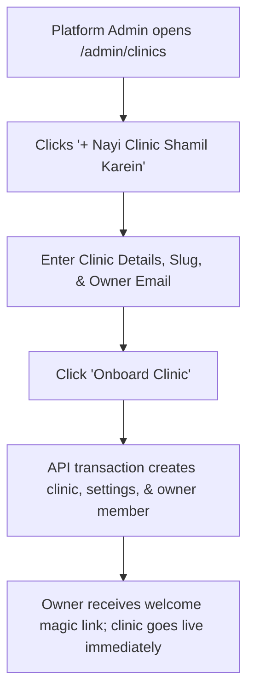

# Page Specification: Platform Admin Clinics Management

> Route: `/admin/clinics`
> Features: F-014 Clinics List, F-013 New Clinic Onboarding (Platform; list/master; P0; roles: platform_admin)
> Standard: `.claude/skills/uiux/references/page-standard.md`

---

## 1. Page overview

- **Purpose of the page:** The master platform management interface for platform super-administrators. Enables viewing all registered clinics across the SaaS, searching by clinic slug/name, auditing active/trial/suspended tenant statuses, and onboarding a new clinic (provisioning clinic profile, owner member, initial settings, and unguessable public slug).
- **The visitor it serves:** Platform super-admin managing multi-tenant clinic onboarding.
- **The one action it must drive:** Onboard a new clinic or monitor existing tenant activity.
- **PRD sections and IDs:** PRD §4 (Platform Admin Navigation), §5.2, §5.3 (F-013, F-014), §3.5 (Multi-Tenancy Scoping).
- **How a visitor arrives:** Platform admin logs in with verified `platform_admin` credential and navigates to `/admin/clinics`.

---

## 2. Section-by-section breakdown

1. **Platform Header & Stats:** Arrival & Overview. Total clinics count, active vs trial tenants, and "+ Nayi Clinic Shamil Karein (Onboard)" button (`bg-surface`).
2. **Clinics Directory Grid:** Main Content. Interactive table displaying Clinic Name, Public Slug, Owner Email, Active Doctors, Status Badge, Created Date, and Actions (`bg-surface`).
3. **Onboard Clinic Modal / Drawer (F-013):** Conversion & Provisioning. Form to register clinic name, public slug, address, time zone (Asia/Karachi), and initial owner email (`bg-surface-raised`).
4. **Tenant Status Change Modal:** Governance. Controlled modal to switch clinic status (`trial` -> `active` -> `suspended`) with mandatory reason input (`bg-surface-sunken`).

---

## 3. Content

- **Page Header:**
  - Title: "Clinics Directory (Platform Admin)"
  - Subtitle: "Tamam registered clinics ki list, status aur naya clinic onboarding."
  - Action Button: "+ Nayi Clinic Shamil Karein (F-013)"
- **Summary Metrics:**
  - Metric 1: "Kul Clinics: 18"
  - Metric 2: "Active Tenants: 14"
  - Metric 3: "Trial: 3"
  - Metric 4: "Suspended: 1"
- **Clinics Grid Column Titles & Sample Data:**
  - Col 1: "Clinic ka Naam" -> `Aapka Family Clinic`
  - Col 2: "Public Slug" -> `/c/aapka-clinic`
  - Col 3: "Owner ka Email" -> `aslam.owner@gmail.com`
  - Col 4: "Doctors Count" -> `2 Doctors`
  - Col 5: "Status" -> `Active Badge (Green)`
  - Col 6: "Joined Date" -> `20-Oct-2026`
  - Col 7: "Actions" -> `[Status Badlein] [Clinic Kholein]`
- **Onboard Clinic Form Controls (F-013):**
  - Clinic Name Label: "Clinic ka Mukammal Naam *"
  - Clinic Name Placeholder: "e.g. Shifa Care Clinic"
  - Slug Label: "Public URL Slug (Unguessable / Custom) *"
  - Slug Placeholder: "shifa-care"
  - Address Label: "Clinic ka Pata (Address) *"
  - Address Placeholder: "Shop 4, Commercial Market, Rawalpindi"
  - Time Zone: "Asia/Karachi (+05:00)"
  - Owner Name Label: "Malik (Owner) ka Mukammal Naam *"
  - Owner Email Label: "Owner ka Login Email Address *"
  - Owner Email Placeholder: "owner@shifacare.com"
- **Primary CTA:**
  - Button Text: "Clinic Onboard Karein / Create Clinic"

---

## 4. Layout structure

- **Mobile Viewport (≤ 640px):** Single column card list, each clinic card showing name, slug, owner email, status pill, and action overflow.
- **Tablet & Desktop Viewport (≥ 641px):** Full-width master data grid with search filter bar; onboarding form opens in a centered 680px modal.

---

## 5. Component breakdown

1. `AdminHeaderBar`: Top platform banner with tenant counters and primary onboarding CTA. State: default. (Reuse).
2. `ClinicsDataTable`: Multi-tenant master grid with sortable columns and status filter. State: loading skeleton, empty, default. (Reuse).
3. `TenantStatusBadge`: Pill badge (`trial` = Info cyan, `active` = Emerald, `suspended` = Danger red). State: default. (Reuse).
4. `OnboardClinicModal`: Step form provisioning clinic and owner user. State: closed, open, submitting. (New).

---

## 6. Visual hierarchy

1. **First:** "+ Nayi Clinic Shamil Karein" primary action button.
2. **Second:** Clinic names and public slugs in the data grid.
3. **Third:** High-contrast tenant status badges (`active`, `trial`, `suspended`).

---

## 7. CTAs

- **Primary CTA:**
  - Label: "+ Nayi Clinic Shamil Karein (F-013)"
  - Position: Header top-right.
  - Variant: `bg-accent text-fg-inverse hover:bg-accent-hover`.
  - Destination / Action: Opens `OnboardClinicModal`.
- **Secondary Actions:**
  - "Status Badlein / Change Status" (Opens modal to suspend or activate clinic).
  - "Filter by Status" (Tab filter: All | Active | Trial | Suspended).

---

## 8. Media

- **Platform Shield Icon:**
  - Purpose: Super-admin security context indicator.
  - Dimensions: 20px × 20px SVG.
- **3D / Heavy Assets:**
  - Not applicable — no 3D elements on this page. Pure lightweight DOM.

---

## 9. Interactions

- **Slug Auto-generation:** Typing clinic name automatically suggests a sanitized lowercase alphanumeric slug with 100ms debounce.
- **Tenant Status Toggle:** Changing status to `suspended` displays an explicit confirmation dialog explaining that staff and patients will be blocked from accessing the clinic.
- **Mobile Variant:** Stacks cards vertically with full touch tap targets for managing clinics on tablet/mobile.
- **Reduced-Motion Variant:** When `prefers-reduced-motion: reduce` is active, modals and dropdowns display instantaneously without fade or zoom animations.

---

## 10. Diagram

```text
+--------------------------------------------------------------------------+
|  Platform Admin - Clinics (18 Clinics)          [+ Nayi Clinic Onboard]  |
|  [ Kul: 18 ]  [ Active: 14 ]  [ Trial: 3 ]  [ Suspended: 1 ]             |
+--------------------------------------------------------------------------+
|  Clinic             | Slug          | Owner Email       | Status | Act   |
|---------------------+---------------+-------------------+--------+-------|
|  Aapka Family Clinic| /c/aapka-cl.. | aslam@gmail.com   | Active | [..]  |
|  City Medical Care  | /c/city-care  | dr.iqbal@city.com | Active | [..]  |
|  Al-Razi Child Care | /c/al-razi    | contact@alrazi.pk | Trial  | [..]  |
+--------------------------------------------------------------------------+
|  [ Modal - Nayi Clinic Onboard Karein (F-013) ]:                         |
|  Clinic ka Naam: [ Shifa Care Clinic                                  ]  |
|  Public Slug:    [ shifa-care        ]  Timezone: [ Asia/Karachi v ]     |
|  Pata (Address): [ Shop 4, Commercial Market, Rawalpindi             ]  |
|  Owner ka Naam:  [ Dr. Kamran                                         ]  |
|  Owner ka Email: [ kamran@shifacare.com                               ]  |
|                                                                          |
|  [ Cancel ]                                   [=== Onboard Clinic ===]   |
+--------------------------------------------------------------------------+
```



---

## 11. Notes

- **Implementation Notes:** Strictly authorized to role `platform_admin`. Platform admin has tenant management authority, but zero access to confidential patient visit notes (PRD §14.2).
- **Performance Risks:** Grid renders immediately.
- **Accessibility Notes:** Accessible table semantics and keyboard navigation.
- **SEO Notes:** `title`: "Platform Admin Clinics Management", `noindex`: true.
