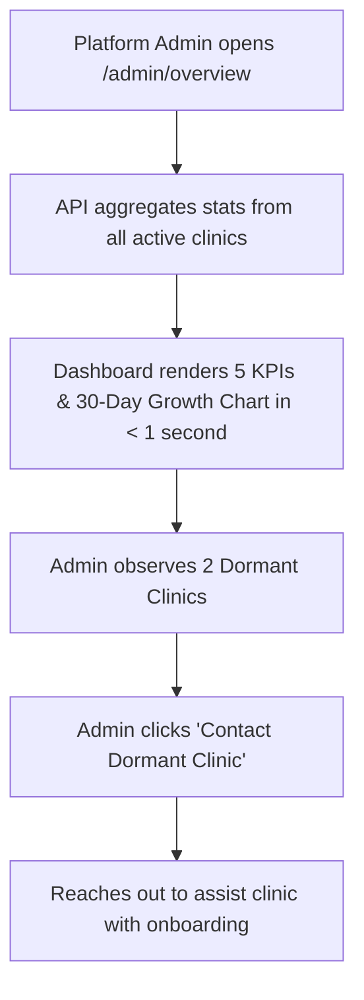

# Page Specification: Platform Overview Dashboard

> Route: `/admin/overview`
> Feature: D-002 Platform Overview Dashboard (Platform; dashboard; P1; roles: platform_admin)
> Standard: `.claude/skills/uiux/references/page-standard.md`

---

## 1. Page overview

- **Purpose of the page:** The SaaS bird's-eye platform dashboard for platform operators and owners. Shows cross-clinic aggregate metrics: Active Clinics count, Tokens Booked Today, 7-Day Platform Token Volume, Dormant Clinics (clinics with zero activity in 3+ days), and Monthly AI Provider Spend across OpenRouter and Gemini.
- **The visitor it serves:** Platform administrators monitoring SaaS health, growth, and infrastructure cost.
- **The one action it must drive:** Monitor multi-tenant platform health and investigate inactive clinics or unexpected AI spend spikes.
- **PRD sections and IDs:** PRD §4 (Platform Navigation), §5.2, §7 (D-002 Platform Overview Dashboard), §36.18 (AI Spend Guardrails).
- **How a visitor arrives:** Platform admin navigates to `/admin/overview`.

---

## 2. Section-by-section breakdown

1. **Platform Header & System Health:** Arrival & Overview. Shows live platform status, total active clinics, and current Asia/Karachi time (`bg-surface`).
2. **Platform KPI Metric Cards (5 Cards):** Key Indicators. Clickable metric cards: Active Clinics, Tokens Today, Tokens 7 Days, Zero-Activity Clinics (3+ days), and AI Spend This Month (`bg-surface`).
3. **Multi-Tenant Token Growth Chart:** Volume Visualization. Recharts area graph depicting daily token bookings across all clinics over the last 30 days (`bg-surface`).
4. **Dormant Clinics Attention Table:** Risk Flags. Table listing clinics with zero tokens generated in 3+ days with direct support outreach links (`bg-surface`).
5. **AI Spend & Provider Health Footnote:** Cost & Guardrails. Breakdown of OpenRouter vs Gemini fallback usage and monthly spend progress toward budget cap (`bg-surface-sunken`).

---

## 3. Content

- **Page Header:**
  - Screen Title: "Platform Overview Dashboard (SaaS Health)"
  - Subtitle: "SaaS platform ke tamam clinics ki aggregate activity aur AI spend."
  - Health Badge: "System Healthy (● All Services Green)"
- **Platform KPI Cards:**
  - Card 1 (Active Clinics): Label "Active Clinics", Value "14 Clinics", Trend "+2 this month", Filter Drill-down `status=active`
  - Card 2 (Tokens Today): Label "Aaj ke Kul Tokens", Value "412 Tokens", Trend "+18% vs kal", Filter Drill-down `tokens_today`
  - Card 3 (Tokens 7 Days): Label "7-Din ka Volume", Value "2,680 Tokens", Trend "Steady 12% week-on-week", Filter Drill-down `tokens_7d`
  - Card 4 (Zero Activity): Label "Zero Activity (3+ Days)", Value "2 Clinics", Subtext "Needs outreach follow-up", Filter Drill-down `dormant`
  - Card 5 (AI Spend This Month): Label "AI Spend This Month", Value "$4.82 USD", Subtext "Budget Cap: $50.00 USD"
- **Platform Token Growth Chart:**
  - Title: "30-Day Platform Token Trajectory"
  - X-Axis: Dates (Daily), Y-Axis: Total Tokens
  - Series: "Total Tokens (Teal Area Graph)"
- **Dormant Clinics Table:**
  - Col 1: "Clinic ka Naam" -> `Madina Care Clinic`
  - Col 2: "City" -> `Faisalabad`
  - Col 3: "Aakhri Token Date" -> `24-Oct-2026 (7 days ago)`
  - Col 4: "Owner Contact" -> `0301 9998877`
  - Col 5: "Action" -> `[Contact Owner] [Inspect Clinic]`

---

## 4. Layout structure

- **Mobile Viewport (≤ 640px):** Single column stack. 2x2 grid for top KPI cards, responsive swipeable token trajectory chart, stacked dormant clinics cards.
- **Tablet Viewport (641px–1024px):** 2-column layout with full-width chart.
- **Desktop Viewport (≥ 1025px):** 12-column grid. Top row hosts 5 KPI cards. Middle row hosts 30-day token growth chart (8 cols) and AI Spend meter (4 cols). Bottom row hosts Dormant clinics table.

---

## 5. Component breakdown

1. `AdminKPIBlock`: Clickable metric card showing value, label, and percentage delta. State: default, hover. (Reuse).
2. `TokenTrajectoryChart`: Recharts responsive area graph. State: loading skeleton, empty, loaded. (New).
3. `DormantClinicsGrid`: Table highlighting inactive clinics. State: empty (good news), rows present. (New).
4. `AISpendProgressMeter`: Gauge bar tracking current month spend against global threshold. State: normal (green), near-cap (amber). (New).

---

## 6. Visual hierarchy

1. **First:** Top row KPI figures ("14 Active Clinics", "412 Tokens Today") in bold `--text-2xl`.
2. **Second:** 30-Day Token Trajectory area chart displaying platform growth.
3. **Third:** Dormant clinics attention list highlighted with amber warning badges.

---

## 7. CTAs

- **Primary CTA:**
  - Label: "Manage Clinics (/admin/clinics) ->"
  - Position: Header top-right.
  - Variant: `bg-accent text-fg-inverse hover:bg-accent-hover`.
  - Destination / Action: Navigates to `/admin/clinics`.
- **Secondary Actions:**
  - "Contact Dormant Clinic" (Opens WhatsApp or dialer link for support outreach).
  - "AI Command Center (D-003)" (Links to AI activity log).

---

## 8. Media

- **Platform Activity Icon:**
  - Purpose: Platform metrics visual header.
  - Dimensions: 20px × 20px SVG.
- **3D / Heavy Assets:**
  - Not applicable — no 3D elements on this page. Pure lightweight DOM.

---

## 9. Interactions

- **Drill-Down Filtering:** Clicking the "Zero Activity" KPI card smoothly scrolls down and focuses the Dormant Clinics table with a 150ms gentle highlight.
- **Area Chart Scrubbing:** Hovering along the area graph displays date and exact token breakdown with 100ms smooth tooltip tracking.
- **Mobile Variant:** Stacks cards vertically with full touch tap targets for managing platform on mobile/tablet.
- **Reduced-Motion Variant:** When `prefers-reduced-motion: reduce` is active, charts render immediately without area height reveal or tooltip transitions.

---

## 10. Diagram

```text
+--------------------------------------------------------------------------+
|  Platform Overview Dashboard (SaaS Health)          [ Manage Clinics -> ]|
+--------------------------------------------------------------------------+
| [ Active Clinics ]  [ Tokens Today ]  [ 7-Day Tokens ]  [ Dormant (3d+) ]|
|       14                  412              2,680               2         |
|   +2 this month        +18% vs kal      Steady growth     Needs outreach |
+--------------------------------------------------------------------------+
|  30-DAY PLATFORM TOKEN TRAJECTORY:                                       |
|  500 |                                            #####                  |
|  400 |                             ##############       ###              |
|  300 |               ##############                                      |
|  200 |  #############                                                    |
|      +----------------------------------------------------               |
|        01-Oct              15-Oct               31-Oct                   |
+--------------------------------------------------------------------------+
|  DORMANT CLINICS ATTENTION (3+ Days Inactive):                           |
|  Clinic             | City        | Last Token Date  | Contact   | Act   |
|  Madina Care Clinic | Faisalabad  | 24-Oct (7d ago)  | 0301 99.. | [Tel] |
|  Al-Huda Family     | Gujranwala  | 27-Oct (4d ago)  | 0322 11.. | [Tel] |
+--------------------------------------------------------------------------+
```



---

## 11. Notes

- **Implementation Notes:** Strictly authorized to role `platform_admin`. Aggregates cross-clinic numbers; never returns individual patient identities or medical notes.
- **Performance Risks:** Must load under 1 second using indexed daily aggregates.
- **Accessibility Notes:** High contrast colors, keyboard accessible data tables.
- **SEO Notes:** `title`: "Platform Overview — Super Admin", `noindex`: true.
