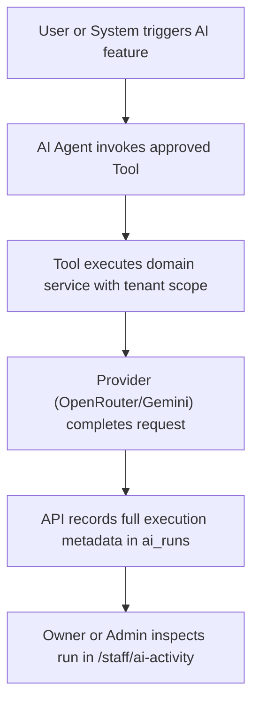

# Page Specification: AI Activity Log & Command Center

> Route: `/staff/ai-activity`
> Features: F-017 AI Activity Log, D-003 AI Command Center Dashboard (AI; list/dashboard; P1; roles: owner, platform_admin)
> Standard: `.claude/skills/uiux/references/page-standard.md`

---

## 1. Page overview

- **Purpose of the page:** The audit and observability command center for all artificial intelligence operations in the application. Displays an auditable log of every AI run (patient chat messages, owner daily briefs, doctor visit notes summaries, and wait-time predictions) including requesting actor, provider (OpenRouter / Gemini fallback), model version, tools executed, input/output tokens, cost in USD, and status. Also presents top-level AI health KPIs and spend cap gauges.
- **The visitor it serves:** Clinic owner (for their own clinic) and platform super-admin (across all clinics).
- **The one action it must drive:** Audit AI calls, verify that data privacy rules are respected, and monitor provider costs.
- **PRD sections and IDs:** PRD §4 (Navigation), §5.2, §5.3 (F-017 AI Activity Log), §7 (D-003 AI Command Center), §36.9 (AI Audit Form), §36.18 (Spend Guardrails).
- **How a visitor arrives:** Clicks "AI Activity & Costs" from the owner menu or platform admin menu.

---

## 2. Section-by-section breakdown

1. **Header & Spend Cap Banner:** Arrival & Cost Guardrails. Monthly AI spend progress bar, active provider indicator (OpenRouter primary / Gemini standby), and clinic filter (`bg-surface`).
2. **AI Command Center KPI Metrics (5 Cards):** Health & Reliability. Clickable cards: Total AI Calls, Success Rate, Fallback Rate (Gemini activations), Monthly Cost (USD), and Negative Feedback Rate (`bg-surface`).
3. **Filter & Search Toolbar:** Data Controls. Filter by AI Agent (Patient Chat / Daily Brief / Visit Summary / Wait Predictor), provider, and outcome status (`bg-surface-sunken`).
4. **AI Runs Audit Log Grid:** Main Content. Interactive table displaying Timestamp, Agent Feature, Requesting Actor, Model, Tools Called (with masked arguments), Tokens, Cost ($), and Status Badge (`bg-surface`).
5. **AI Run Details Drawer:** Inspection. Sliding panel showing the masked prompt, tool inputs/outputs, and response trace (`bg-surface-raised`).

---

## 3. Content

- **Page Header:**
  - Screen Title: "AI Activity Log aur Command Center (D-003 / F-017)"
  - Subtitle: "Clinic ke tamam AI features ka audit log, provider kharcha aur tools ka record."
  - Provider Status: "Primary: OpenRouter (Active) | Fallback: Google Gemini (Standby)"
- **KPI Metrics (D-003):**
  - Card 1 (Total Calls): Label "Kul AI Calls (This Month)", Value "842 Calls", Trend "+24% vs last month"
  - Card 2 (Success Rate): Label "Kamyabi ka Tanasub", Value "99.4%", Trend "Target: ≥ 98%"
  - Card 3 (Fallback Rate): Label "Fallback Usage (Gemini)", Value "0.6%", Trend "5 calls routed to fallback"
  - Card 4 (Monthly Cost): Label "Mahana AI Kharcha", Value "$1.42 USD", Subtext "Monthly Cap: $2.00 USD"
  - Card 5 (Feedback): Label "Negative Feedback Rate", Value "1.2%", Subtext "Thumbs-down on briefs/chat"
- **Grid Column Titles & Sample Data:**
  - Col 1: "Waqt (Timestamp)" -> `31-Oct 09:00 PM`
  - Col 2: "AI Feature" -> `Daily Brief (L1-L2)`
  - Col 3: "Actor" -> `System Cron (Scheduled)`
  - Col 4: "Provider / Model" -> `OpenRouter / meta-llama-3`
  - Col 5: "Tools Called" -> `get_daily_stats(), detect_anomalies()`
  - Col 6: "Tokens" -> `842 in / 148 out`
  - Col 7: "Cost (USD)" -> `$0.0014`
  - Col 8: "Status" -> `Success Badge (Green)`
  - Col 9: "Actions" -> `[Trace Kholein]`
- **Run Details Drawer:**
  - Title: "AI Run Trace — Run #842"
  - Redaction Notice: "PII Masking Active: Patient phone numbers and full names are permanently masked."
  - Tools Execution Log: "`get_daily_stats(clinic_id='...', date='2026-10-31')` -> Returned 42 tokens, 38 seen."

---

## 4. Layout structure

- **Mobile Viewport (≤ 640px):** Single column stack. 2x2 grid for top KPI cards, followed by audit cards with tap-to-expand trace drawer.
- **Tablet & Desktop Viewport (≥ 641px):** Full-width master data grid with top 5 KPI cards; clicking a trace opens a 560px sliding drawer on the right.

---

## 5. Component breakdown

1. `AIHeaderSpendMeter`: Header displaying monthly spend progress gauge. State: default, warning near cap. (New).
2. `AIKPICard`: Reusable metric card for AI health indicators. State: default, hover. (Reuse).
3. `AIRunsTable`: Dense table with tool pill tags and cost formatting. State: loading skeleton, empty, default. (Reuse).
4. `AITraceDrawer`: Sliding side sheet showing sanitized prompts and tool arguments. State: closed, open. (New).

---

## 6. Visual hierarchy

1. **First:** Monthly AI Spend gauge showing current spend vs. the $2.00 USD clinic cap.
2. **Second:** Success Rate and Fallback Rate KPI indicators.
3. **Third:** AI Runs Audit table with tool execution tags and cost per call.

---

## 7. CTAs

- **Primary CTA:**
  - Label: "Export AI Audit Log (CSV)"
  - Position: Header top-right.
  - Variant: `bg-accent text-fg-inverse hover:bg-accent-hover`.
  - Destination / Action: Triggers download of compliance audit log.
- **Secondary Actions:**
  - "Inspect Run Trace" (Opens side drawer displaying masked parameters).
  - "Filter by Agent" (Select menu: Patient Chat | Daily Brief | Visit Summary | Wait Predictor).

---

## 8. Media

- **Provider Badges:**
  - Purpose: Clear differentiation between OpenRouter and Gemini fallback calls.
  - Badges: `[OpenRouter]` (neutral outline), `[Gemini Fallback]` (amber warning outline).
- **3D / Heavy Assets:**
  - Not applicable — no 3D elements on this page. Pure lightweight DOM.

---

## 9. Interactions

- **Trace Drawer Open:** Clicking a row opens the trace drawer with a 240ms cubic-bezier ease-out transition.
- **Tool Payload Toggle:** Clicking any tool tag in the drawer expands the JSON payload with formatted syntax highlighting.
- **Mobile Variant:** Full-width layout with touch-friendly drawer sliding up from the bottom.
- **Reduced-Motion Variant:** When `prefers-reduced-motion: reduce` is active, trace drawer opens instantaneously without slide or backdrop fade transitions.

---

## 10. Diagram

```text
+--------------------------------------------------------------------------+
|  AI Activity Log & Command Center                   [ Export AI Log CSV ]|
|  Monthly Spend: [====== $1.42 / $2.00 USD (71%) ======]  Primary: OpenRout
+--------------------------------------------------------------------------+
| [ Kul AI Calls ]  [ Kamyabi % ]  [ Fallback Rate ]  [ Spend ]  [ Thumbs- ]|
|       842             99.4%            0.6%          $1.42       1.2%    |
|   +24% vs mo        All green       5 to Gemini    Under Cap    Low risk |
+--------------------------------------------------------------------------+
|  Filter: [ All Agents v ]  [ All Providers v ]  [ All Statuses v ]        |
+--------------------------------------------------------------------------+
|  Timestamp   | Agent       | Provider    | Tools Called       | Cost ($) |
|--------------+-------------+-------------+--------------------+----------|
|  31-Oct 9pm  | Daily Brief | OpenRouter  | get_daily_stats()  | $0.0014  |
|  31-Oct 8pm  | PatientChat | OpenRouter  | get_my_token()     | $0.0003  |
|  31-Oct 7pm  | VisitSumm   | Gemini (FB) | get_history()      | $0.0008  |
+--------------------------------------------------------------------------+
|  [ Drawer - Run #842 Trace ]:                                            |
|  Feature: Daily Brief  |  Duration: 1.8s  |  Status: 200 OK              |
|  Tools: get_daily_stats(clinic_id='...', date='31-Oct')                  |
|  Result: 42 tokens, 38 seen. PII Masked. Zero phone numbers sent.        |
+--------------------------------------------------------------------------+
```



---

## 11. Notes

- **Implementation Notes:** Scoped by `clinic_id` for clinic owners; cross-clinic visibility restricted to `platform_admin`. Prompt traces strictly mask personal identifiable information (PRD §36.18).
- **Performance Risks:** Grid is paginated with hard cursor limits (`limit=50`).
- **Accessibility Notes:** Monospace numeric tokens and tabular layout.
- **SEO Notes:** `title`: "AI Command Center & Audit Log", `noindex`: true.
