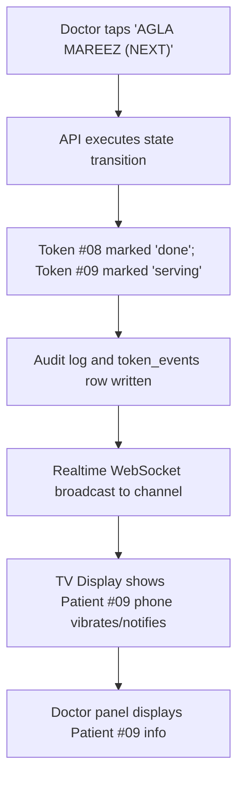

# Page Specification: Doctor Panel (Next Patient)

> Route: `/staff/doctor`
> Feature: F-007 Next Patient (Doctor; transaction; P0; roles: doctor)
> Standard: `.claude/skills/uiux/references/page-standard.md`

---

## 1. Page overview

- **Purpose of the page:** The consultation desk screen used by the doctor during OPD hours. With a single tap, the doctor calls the next patient ("NEXT"), transitions patient status, and triggers live updates across the waiting room TV and the patient's smartphone within 3 seconds. Also provides quick Hold, Skip, and Recall actions.
- **The visitor it serves:** Consulting doctor sitting inside the clinical examination room.
- **The one action it must drive:** Tap "AGLA MAREEZ / NEXT" to advance the queue and view the patient's medical details.
- **PRD sections and IDs:** PRD §4 (Doctor Navigation), §5.2, §5.3 (F-007 Next Patient), §10 (W-004 Doctor Queue Flow).
- **How a visitor arrives:** Doctor logs in via email magic link and is automatically routed to `/staff/doctor`.

---

## 2. Section-by-section breakdown

1. **Doctor Desk Header:** Arrival & Shift Info. Shows doctor's name, assigned room number, OPD schedule timing, and current queue count (`bg-surface`).
2. **Current Patient Active Hero:** Main Focus. Large card displaying currently serving token, patient name, arrival time, and direct link to visit notes (`bg-surface`).
3. **Queue Action Control Bar:** Primary Conversion. High-contrast primary action buttons: "AGLA MAREEZ / NEXT", "Skip / Aage Badhein", "Hold / Rok Dein", and "Recall" (`bg-surface`).
4. **Upcoming Queue Preview Rail:** Continuity. Ordered list of the next 5 arriving patients with status pills (`bg-surface-sunken`).
5. **Held & Skipped Patients Drawer:** Exception Handling. Quick access tab to bring back held or skipped patients (`bg-surface`).

---

## 3. Content

- **Header Section:**
  - Doctor Identity: "Dr. Tariq Khan — Kamra No. 1 (General OPD)"
  - OPD Hours: "Shaam 05:00 PM - 09:00 PM"
  - Shift Progress: "14 Mareez Dekh Liye | 18 Baqi Hain"
- **Current Patient Active Card:**
  - Card Heading: "KAMREY MEIN MOJOOD MAREEZ (CURRENT)"
  - Token Number: "#08"
  - Patient Name: "Muhammad Ali (34 saal, Mard)"
  - Mobile Number: "0300 1234567"
  - Arrival Time: "Pohnche: 06:15 PM (15 min se waiting)"
  - Source: "Online Booked"
- **Queue Action Bar Controls:**
  - Primary Button: "AGLA MAREEZ (NEXT) ->"
  - Secondary Button: "Hold / Intezaar (Kamrey se bahar)"
  - Warning Button: "Skip / Chhor Dein (Ghair-hazir)"
  - Action Link: "Mareez ki Purani History aur Nuskha Likhein (F-008) ->"
- **Upcoming Queue List:**
  - Item 1: "#09 — Fatima Bibi (Arrived, waiting 10 min)"
  - Item 2: "#10 — Usman Shah (Arrived, waiting 5 min)"
  - Item 3: "#11 — Zainab Akhtar (Online, not yet arrived)"
  - Item 4: "#12 — Tariq Mehmood (Walk-in, arrived)"

---

## 4. Layout structure

- **Mobile & Tablet Viewport (≤ 1024px):** Single column, large touch targets (52px button heights for Next/Skip), high contrast for tablet desk stands.
- **Desktop Viewport (≥ 1025px):** Two-column split layout: Left side (60% width) hosts the current patient hero card and primary action buttons; Right side (40% width) displays the live upcoming queue and held patient drawer.

---

## 5. Component breakdown

1. `DoctorHeaderDesk`: Shift and room information bar. State: active, OPD ended. (New).
2. `ActivePatientCard`: Prominent current token container with patient demographics. State: patient in room, no active patient (empty state). (New).
3. `QueueControlBar`: Extra-large "NEXT", "HOLD", "SKIP" buttons with touch feedback. State: ready, advancing (spinner), disabled when queue empty. (New).
4. `UpcomingQueueList`: Real-time ordered list of waiting patients. State: default, live re-ordering on NEXT. (New).
5. `HeldPatientModal`: Modal to re-call or mark no-show for skipped patients. State: closed, open. (New).

---

## 6. Visual hierarchy

1. **First:** Massive "AGLA MAREEZ (NEXT)" button rendered in `--color-accent` (or emerald `--color-success`).
2. **Second:** Current patient token number (`#08`) and patient name.
3. **Third:** Upcoming queue rail showing who is next outside the door.

---

## 7. CTAs

- **Primary CTA:**
  - Label: "AGLA MAREEZ (NEXT) ->"
  - Position: Center stage below active patient details.
  - Variant: `bg-accent text-fg-inverse text-lg font-bold py-3 px-6 rounded-lg shadow-md hover:bg-accent-hover`.
  - Destination / Action: Calls `POST /api/v1/queues/{doctor_id}/next`.
  - Success State: Advances token `#08` to `done`, calls `#09` into room, updates TV and phones via Realtime broadcast.
- **Secondary Actions:**
  - "Visit Note Likhein (F-008)" (Direct link to clinical consultation screen).
  - "Hold" (Calls `POST /api/v1/queues/{doctor_id}/hold`).
  - "Skip" (Calls `POST /api/v1/queues/{doctor_id}/skip`).

---

## 8. Media

- **Doctor Room Badge:**
  - Purpose: Identifies consulting room context.
  - Dimensions: Pill tag (`bg-surface-sunken border text-xs font-mono`).
- **3D / Heavy Assets:**
  - Not applicable — no 3D elements on this page. Pure lightweight DOM.

---

## 9. Interactions

- **Tap "NEXT":** Button pulses with a 150ms tactile feedback, updates active patient card with a smooth 180ms ease-out slide-in transition, and fires Realtime broadcast to TV and patients.
- **Hold / Skip Toggle:** Removes patient from active position and places into the "Held" drawer with a gentle warning chip.
- **Mobile Variant:** Pinned 56px bottom touch bar containing "NEXT" and "SKIP" buttons for one-handed thumb tapping on mobile/tablet.
- **Reduced-Motion Variant:** When `prefers-reduced-motion: reduce` is active, patient transitions and queue updates change immediately without slide or scale effects.

---

## 10. Diagram

```text
+--------------------------------------------------------------------------+
|  Dr. Tariq Khan - Kamra No. 1 (OPD)              [ 14 Dekh Liye | 18 Baqi]
+--------------------------------------------------------------------------+
|  KAMREY MEIN MOJOOD (NOW SERVING):       |  AGLE MAREEZ (UPCOMING):      |
|                                          |                               |
|               #08                        |  #09 - Fatima Bibi (Aa Gayi)  |
|      Muhammad Ali (34 saal)              |  #10 - Usman Shah (Aa Gaye)   |
|      Mobile: 0300 1234567                |  #11 - Zainab (Online)        |
|      Waqt: 06:15 PM (Waiting 15m)        |  #12 - Tariq Mehmood (Walkin) |
|                                          |                               |
|  [=== AGLA MAREEZ (NEXT) - #09 =======]  |  [ Held / Skipped (2) ]       |
|  [ Hold (Intezaar) ]  [ Skip (Nahi Aaye)]|                               |
|                                          |                               |
|  [---> Mareez ki Purani History aur Nuskha Likhein (F-008) --->]         |
+--------------------------------------------------------------------------+
```



---

## 11. Notes

- **Implementation Notes:** Strictly authorized to role `doctor` (scoped to `doctor_id`). Doctor can only advance their own queue.
- **Performance Risks:** Tap-to-update roundtrip must achieve p95 ≤ 300 ms so doctor consultation pace is never impeded.
- **Accessibility Notes:** Keyboard shortcut: `Spacebar` or `Ctrl+N` to advance NEXT; `Ctrl+H` to Hold.
- **SEO Notes:** `title`: "Doctor Consultation Panel", `noindex`: true.
