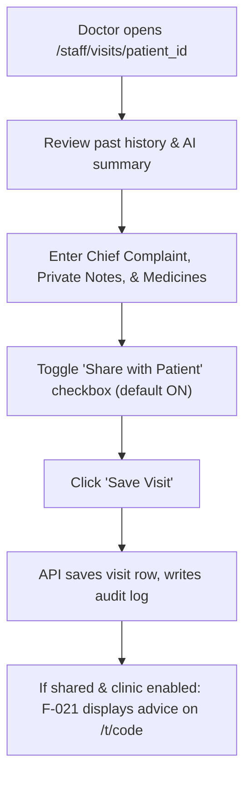

# Page Specification: Patient History & Visit Note

> Route: `/staff/visits/{patient-id}`
> Feature: F-008 Patient History & Visit Note (Doctor; transaction; P1; roles: doctor)
> Standard: `.claude/skills/uiux/references/page-standard.md`

---

## 1. Page overview

- **Purpose of the page:** Clinical consultation workspace for the doctor to review the patient's previous medical visits, read an optional 5-line AI summary of past complaints, record current clinical notes (private), and write prescription/lifestyle advice (which can optionally be shared with the patient via F-021).
- **The visitor it serves:** The consulting doctor during or immediately after examination.
- **The one action it must drive:** Enter visit notes and tap "Save Visit / Nuskha Mehfooz Karein".
- **PRD sections and IDs:** PRD §4 (Doctor Navigation), §5.2, §5.3 (F-008 Patient History & Visit Note), §14.3 (Data Privacy), §36.11 (AI Visit Summarizer).
- **How a visitor arrives:** Clicks "Mareez History & Note" from F-007 Doctor Panel or selects a patient from the directory.

---

## 2. Section-by-section breakdown

1. **Patient Demographic Banner:** Arrival & Context. Displays patient name, age, gender, phone, and allergy alert tags (`bg-surface`).
2. **AI Past History Summary Card:** Fast Clinical Catch-up. 5-bullet concise summary of prior visits generated by AI (only active when clinic setting allows) (`bg-surface-sunken`).
3. **Past Visits Timeline Rail:** Historical Depth. Reverse chronological list of past consultation dates, complaints, and prescribed medications (`bg-surface`).
4. **Current Visit Note Editor:** Clinical Documentation. Fields for Chief Complaint, Clinical Examination / Private Notes, and Medicines / Advice (`bg-surface`).
5. **Patient Sharing Toggle:** Privacy Control. Explicit checkbox: "[x] Yeh dawa aur hidayat mareez ko token link par dikhayein (Share Advice)" (`bg-surface-sunken`).
6. **Action Bar:** Primary Conversion. Save Visit button and Return to Queue button (`bg-surface`).

---

## 3. Content

- **Patient Demographics:**
  - Patient Name: "Muhammad Ali (Mard, 34 saal)"
  - Mobile: "0300 1234567"
  - Medical Alert Pill: "Allergy: Penicillin (Severe)"
  - Visit Count: "6th Visit at Aapka Clinic"
- **AI Past History Summary:**
  - Card Title: "AI Sabqa History Summary (L1 Assistant)"
  - Disclaimer: "AI summary — check before use. Sirf pichli 10 visits ka khulasa."
  - Bullet 1: "14-Oct-2026: Season flu aur khansi, Panadol aur syrup diya gaya."
  - Bullet 2: "02-Sep-2026: Blood pressure 130/85, routine checkup, koi complication nahi."
  - Bullet 3: "18-May-2026: Gale mein dard aur bukhar, Azithromycin tajweez ki gayi."
- **Current Visit Entry Fields:**
  - Chief Complaint Label: "Alamaat / Chief Complaint *"
  - Chief Complaint Placeholder: "e.g. Bukhar 3 din se, sar dard..."
  - Private Clinical Notes Label: "Doctor ke Zaati Notes (Private — Mareez ko kabhi nahi dikhte) *"
  - Private Notes Placeholder: "Chest clear, BP 120/80, no wheezing..."
  - Medicines & Advice Label: "Dawa aur Hidayat (Medicines & Advice) *"
  - Medicines Placeholder: "1. Tab Panadol 500mg (1 subah, 1 shaam - 3 din)\n2. Joshanda saaf pani mein piyein"
- **Sharing & Consent:**
  - Checkbox Label: "[x] Yeh dawa aur hidayat mareez ko token link par dikhayein (F-021)"
  - Helper Note: "Private notes kabhi share nahi honge. Sirf dawa aur hidayat dikhegi."
- **Primary CTA:**
  - Button Text: "Visit Mehfooz Karein / Save Visit"

---

## 4. Layout structure

- **Mobile Viewport (≤ 640px):** Single column, collapsible accordion for past history, full-width textareas for notes, sticky bottom save button.
- **Tablet & Desktop Viewport (≥ 641px):** Two-column consultation layout: Left column (35% width) shows patient details, allergy warnings, and past visit timeline; Right column (65% width) holds the active clinical notes form and prescription editor.

---

## 5. Component breakdown

1. `PatientDemographicsCard`: Header with allergy badge and patient identity. State: default. (Reuse).
2. `AISummaryCard`: Collapsible AI summary with amber verification chip. State: generating, loaded, disabled by setting. (New).
3. `PastVisitTimeline`: Chronological list of past visits with doctor names and dates. State: loading, empty, loaded. (New).
4. `ClinicalNotesEditor`: Markdown/text editor with separate Private and Public sections. State: default, dirty, saving. (New).
5. `PatientShareToggle`: Accessible checkbox with clear privacy iconography. State: checked, unchecked, disabled if clinic disallowed. (New).
6. `SaveVisitBar`: Sticky footer bar with Cancel and Save buttons. State: default, loading, saved. (Reuse).

---

## 6. Visual hierarchy

1. **First:** Red/Amber allergy alert tag ("Allergy: Penicillin") at the top left.
2. **Second:** Current visit entry textareas (Chief Complaint & Medicines).
3. **Third:** High-contrast blue "Save Visit" button.

---

## 7. CTAs

- **Primary CTA:**
  - Label: "Visit Mehfooz Karein / Save Visit"
  - Position: Right-aligned in sticky bottom action bar.
  - Variant: `bg-accent text-fg-inverse hover:bg-accent-hover`.
  - Destination / Action: Calls `POST /api/v1/patients/{id}/visits`.
  - Success State: Shows success toast and redirects back to Doctor Panel (`/staff/doctor`).
- **Secondary Actions:**
  - "Generate AI Summary" (Triggers `POST /api/v1/visits/{id}/ai-summary`).
  - "Wapis Panel par Jayein / Back to Queue" (Secondary outline button).

---

## 8. Media

- **Lock Icon:**
  - Purpose: Clearly marks the Private Doctor Notes field as strictly confidential.
  - Dimensions: 16px × 16px inline SVG.
- **3D / Heavy Assets:**
  - Not applicable — no 3D elements on this page. Pure lightweight DOM.

---

## 9. Interactions

- **AI Summary Expand:** Clicking "AI Summary" toggles the 5-bullet summary card with 180ms ease-out height expand.
- **Auto-draft Save:** Notes draft automatically saves to browser localStorage every 15 seconds to protect against accidental tab closure.
- **Mobile Variant:** Stacks timeline below editor; sticky bottom bar with full-width save button.
- **Reduced-Motion Variant:** When `prefers-reduced-motion: reduce` is active, accordions and modal panels toggle without height or opacity animations.

---

## 10. Diagram

```text
+--------------------------------------------------------------------------+
|  Muhammad Ali (34y, M)  |  Mobile: 0300 1234567  |  [! Allergy: Penicillin]
+--------------------------------------------------------------------------+
|  PURANA RECORD (HISTORY):        |  AAJ KA VISIT NOTE:                   |
|                                  |                                       |
|  [AI Summary - Check before use] |  Alamaat (Chief Complaint):           |
|  * 14-Oct: Season flu & cough    |  [ Bukhar 3 din se, sar dard        ] |
|  * 02-Sep: BP 130/85 normal      |                                       |
|                                  |  Doctor Private Notes (Mehfooz):      |
|  Past Visits:                    |  [ Chest clear, throat congested... ] |
|  > 14-Oct-2026 (Dr. Tariq Khan)  |                                       |
|    Flu & throat infection        |  Dawa aur Hidayat (Medicines):        |
|  > 02-Sep-2026 (Dr. Ayesha Noor) |  [ 1. Panadol 500mg 1 tab subah/sham] |
|    Routine checkup               |  [ 2. Joshanda garam pani mein...   ] |
|                                  |                                       |
|                                  |  [x] Yeh dawa mareez ko dikhayein     |
|                                  |                                       |
|                                  |  [=== Visit Mehfooz Karein (Save) ==] |
+--------------------------------------------------------------------------+
```



---

## 11. Notes

- **Implementation Notes:** Private visit `notes` are strictly quarantined from public endpoints. The patient endpoint `/public/tokens/{code}/advice` returns *only* `medicines_advice` when both the clinic setting `share_advice_with_patient` and the visit checkbox `share_with_patient` are true.
- **Performance Risks:** Must load past visit history within 250 ms.
- **Accessibility Notes:** Semantic form elements with explicit labels. Tabular keyboard movement.
- **SEO Notes:** `title`: "Clinical Visit Notes — Doctor", `noindex`: true.
