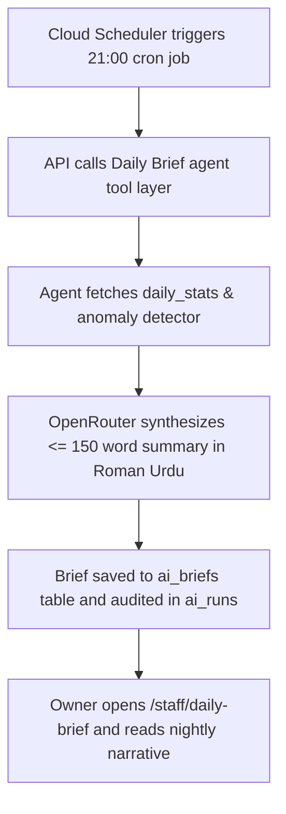

# Page Specification: Owner Daily AI Brief

> Route: `/staff/daily-brief`
> Feature: F-018 Daily Brief (AI; report; P2; roles: owner)
> Standard: `.claude/skills/uiux/references/page-standard.md`

---

## 1. Page overview

- **Purpose of the page:** Nightly executive narrative generated autonomously at 21:00 clinic time by an AI agent (L1-L2 autonomy level). Summarizes today's operations in ≤ 150 words (patients seen, average wait time, no-show trends, and comparisons against 7-day rolling averages) with up to 3 flagged anomalies linked directly to records.
- **The visitor it serves:** Clinic owner reading a quick 2-minute summary on mobile before closing the clinic.
- **The one action it must drive:** Read the nightly briefing and review any detected operational anomalies.
- **PRD sections and IDs:** PRD §4 (Owner Navigation), §5.2, §5.3 (F-018 Daily Brief), §36.12 (Daily Brief Agent), §36.16 (Anomaly Detection).
- **How a visitor arrives:** Clicks "AI Daily Brief" from the owner dashboard or navigates to `/staff/daily-brief`.

---

## 2. Section-by-section breakdown

1. **Header & Date Selector:** Arrival & Context. Date picker (default: Today), AI generation timestamp, and clinic name (`bg-surface`).
2. **Executive Summary Card:** Main Narrative. Formatted markdown narrative summarizing patient volume, peak hours, and staff efficiency (`bg-surface`).
3. **Detected Anomalies Rail:** Risk & Exception Flags. Up to 3 actionable anomaly cards with direct record links (e.g. high no-show surge, doctor OPD delay) (`bg-surface-raised`).
4. **Historical Briefs Archive:** Temporal Depth. Calendar or list to browse previous daily briefings (`bg-surface-sunken`).
5. **Feedback & Thumbs Action:** Governance & Quality. Quick "Was this brief helpful? (Thumbs Up / Down)" rating widget (`bg-surface`).

---

## 3. Content

- **Page Header:**
  - Screen Title: "Rozana AI Brief (Daily Executive Summary)"
  - Subtitle: "Har roz raat 9:00 baje clinic ki mukammal kar-kardagi ka AI khulasa."
  - Generated Timestamp: "Generated at 09:00 PM PKT by OpenRouter (L1-L2 Agent)"
- **Executive Summary Markdown Body:**
  - Headline: "Aapka Clinic — 31 October 2026 Summary"
  - Summary Paragraph: "Aaj kul 42 tokens book huay jin mein se 38 mareezon ka checkup mukammal hua. Average intezaar ka waqt 18 minute raha jo pichle 7 din ke average (22 min) se 4 minute behtar hai. Online booking ka hissa 68% raha jo pichle haftay se 12% zyada hai. Shaam 6:00 PM se 7:30 PM tak clinic mein sab se zyada rush raha."
- **Detected Anomalies Section:**
  - Section Heading: "Ahem Nishandahi (Detected Anomalies)"
  - Anomaly Card 1: "[Warning] No-show Rate Surge: Aaj 4 mareez online booking ke bawajood nahi aaye (8% vs 4% average). [Record Dekhein ->]"
  - Anomaly Card 2: "[Info] Dr. Tariq Khan ne aaj 24 mareez dekhe aur average consult time 5.8 minute raha jo clinic schedule ke bilkul mutabiq hai."
- **Feedback Controls:**
  - Prompt: "Kya yeh brief clinic ke liye mufeed tha? [👍 Mufeed] [👎 Behtar karein]"

---

## 4. Layout structure

- **Mobile Viewport (≤ 640px):** Single column vertical stack, large legible typography for easy mobile reading, anomaly cards with full-width tap targets.
- **Tablet & Desktop Viewport (≥ 641px):** Centered card layout, max-width 720px (`--layout-form-max`), generous 20px padding and clean whitespace.

---

## 5. Component breakdown

1. `BriefHeaderBar`: Header showing generation time and date selector. State: default. (Reuse).
2. `BriefNarrativeCard`: Styled markdown card displaying executive text. State: loading skeleton, empty, loaded. (New).
3. `AnomalyAlertCard`: Colored border card with warning badge and drill-down link. State: default, clicked. (New).
4. `BriefFeedbackPill`: Interactive thumbs up/down rating widget. State: unvoted, voted (thank you message). (New).

---

## 6. Visual hierarchy

1. **First:** Briefing date and total patients seen headline.
2. **Second:** Executive summary narrative text block.
3. **Third:** Highlighted anomaly cards with warning badges.

---

## 7. CTAs

- **Primary CTA:**
  - Label: "Roz ki Report Dekhein (F-010) ->"
  - Position: Pinned below the summary.
  - Variant: `bg-accent text-fg-inverse hover:bg-accent-hover`.
  - Destination / Action: Navigates to `/staff/reports`.
- **Secondary Actions:**
  - "Record Dekhein / View Anomaly Record" (Links to filtered `/staff/aaj-ki-list`).
  - "👍 Mufeed / 👎 Behtar karein" (Submits feedback to `ai_briefs.feedback`).

---

## 8. Media

- **AI Sparkle Icon:**
  - Purpose: Visual cue indicating AI-generated intelligence.
  - Dimensions: 20px × 20px inline SVG (`text-accent`).
- **3D / Heavy Assets:**
  - Not applicable — no 3D elements on this page. Pure lightweight DOM.

---

## 9. Interactions

- **Feedback Tap:** Clicking thumbs up or down records feedback via API and displays a 150ms gentle thank-you chip.
- **Date Picker Jump:** Selecting a previous date smoothly fetches the archived brief with a 180ms ease-out fade.
- **Mobile Variant:** Optimized for bedtime reading on phones with high text contrast and tap-friendly anomaly links.
- **Reduced-Motion Variant:** When `prefers-reduced-motion: reduce` is active, archived briefs switch without fade or slide transitions.

---

## 10. Diagram

```text
+--------------------------------------------------------------------------+
|  Rozana AI Brief (31 October 2026)                   [ Calendar Archive ]|
|  * Generated autonomously at 09:00 PM PKT by OpenRouter                  |
+--------------------------------------------------------------------------+
|  EXECUTIVE SUMMARY:                                                      |
|  Aaj kul 42 tokens book huay jin mein se 38 mareezon ka checkup          |
|  mukammal hua. Average intezaar ka waqt 18 minute raha jo pichle 7       |
|  din ke average se 4 minute behtar hai. Online booking ka hissa 68% raha.|
+--------------------------------------------------------------------------+
|  DETECTED ANOMALIES (2 Nishandahi):                                      |
|  [!] No-Show Surge: Aaj 4 mareez online booking ke bawajood nahi aaye.   |
|      [ Dekhein: Aaj ki List (Filtered) -> ]                              |
|  [i] Peak Hour: Shaam 6:00 PM se 7:30 PM sab se zyada rush raha.         |
+--------------------------------------------------------------------------+
|  Kya yeh summary theek tha?  [ (y) Mufeed ]  [ (n) Behtar karein ]       |
+--------------------------------------------------------------------------+
```



---

## 11. Notes

- **Implementation Notes:** Strictly authorized to role `owner`. AI agent has zero direct SQL authority; reaches stats only through read-only tools.
- **Performance Risks:** Pre-computed at 21:00; page load is an instantaneous single row read from `ai_briefs`.
- **Accessibility Notes:** Semantic headings and high-contrast typography.
- **SEO Notes:** `title`: "Daily AI Executive Brief — Owner", `noindex`: true.
