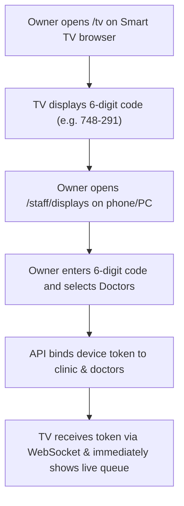

# Page Specification: Display Device Pairing

> Route: `/staff/displays`
> Feature: F-020 Display Device Pairing (Owner; settings; P0; roles: owner)
> Standard: `.claude/skills/uiux/references/page-standard.md`

---

## 1. Page overview

- **Purpose of the page:** Allow the clinic owner to pair and manage wall-mounted TV screens and waiting room monitors without requiring staff to log in with an email account on public television browsers. Provides a 6-digit pairing code workflow and one-click token revocation.
- **The visitor it serves:** Clinic owner or administrator pairing TV hardware in the waiting area.
- **The one action it must drive:** Pair a new TV screen by entering the pairing code displayed on the TV.
- **PRD sections and IDs:** PRD §4 (Owner Navigation), §5.2, §5.3 (F-020 Display Pairing), §12.3 (display_devices).
- **How a visitor arrives:** Clicks "TV Displays" from the owner settings menu.

---

## 2. Section-by-section breakdown

1. **Header & Active Displays Summary:** Arrival & Context. Active TV displays count, pairing guide, and "+ Naya TV Screen Pair Karein" button (`bg-surface`).
2. **Paired Displays Grid:** Main Content. Table displaying Display Name, Assigned Doctors, Paired Date, Last Heartbeat, and Revoke action (`bg-surface`).
3. **TV Pairing Modal:** Configuration. Form to enter 6-digit pairing code shown on `/tv`, name the screen (e.g. "Main Waiting Area TV"), and select assigned doctors (`bg-surface-raised`).
4. **Security Notice Footnote:** Reassurance. Confirmation that display tokens are hashed and carry zero patient personal data (`bg-surface-sunken`).

---

## 3. Content

- **Page Header:**
  - Title: "TV Screen Pairing (Waiting Room Displays)"
  - Subtitle: "Waiting room ke TV ko login kiye baghair ek code se connect karein."
  - Action Button: "+ Naya TV Screen Pair Karein / Pair New TV"
- **Paired Displays Table Column Titles & Sample Data:**
  - Col 1: "Screen ka Naam" -> `Main Waiting Area TV`
  - Col 2: "Assigned Doctors" -> `Dr. Tariq Khan, Dr. Ayesha Noor`
  - Col 3: "Device Status" -> `Connected (● Live)`
  - Col 4: "Paired Date" -> `20-Oct-2026`
  - Col 5: "Actions" -> `[Doctors Badlein] [Revoke Token]`
- **Pairing Modal Controls:**
  - Modal Heading: "Naya TV Pair Karein (Pair Device)"
  - Step 1 Guide: "1. TV browser par 'clinic-url/tv' kholein. Wahan 6-digit code nazar aayega."
  - Code Label: "TV par nazar aane wala 6-Digit Code *"
  - Code Placeholder: "e.g. 748-291"
  - Screen Name Label: "Is TV Screen ka Naam *"
  - Screen Name Placeholder: "e.g. Ground Floor Waiting Area"
  - Doctor Selection: "Konsay doctors ke tokens is screen par dikhayein? [x] Dr. Tariq [x] Dr. Ayesha"
- **Primary CTA:**
  - Button Text: "TV Connect Karein / Confirm Pairing"

---

## 4. Layout structure

- **Mobile Viewport (≤ 640px):** Single column card list, each card showing screen name, live connection status, and a prominent "Revoke" button. Add button pinned at top.
- **Tablet & Desktop Viewport (≥ 641px):** Full-width master data grid with pairing code modal (480px width) centered on activation.

---

## 5. Component breakdown

1. `DisplayHeaderBar`: Header with paired device count and pairing button. State: default. (Reuse).
2. `PairedDevicesTable`: Table showing active display devices and assigned doctor tags. State: loading skeleton, empty, default. (Reuse).
3. `PairingCodeModal`: Modal with segmented 6-digit numeric input box. State: closed, open, verifying. (New).
4. `RevokeDeviceDialog`: Destructive confirmation dialog before unpairing. State: closed, open. (Reuse).

---

## 6. Visual hierarchy

1. **First:** "+ Naya TV Screen Pair Karein" primary button.
2. **Second:** Active TV displays table and connection status dots.
3. **Third:** Revoke access button in trailing action column.

---

## 7. CTAs

- **Primary CTA:**
  - Label: "+ Naya TV Screen Pair Karein"
  - Position: Header top-right.
  - Variant: `bg-accent text-fg-inverse hover:bg-accent-hover`.
  - Destination / Action: Opens `PairingCodeModal`.
- **Secondary Actions:**
  - "Revoke Token / Disconnect TV" (Calls `POST /api/v1/displays/{id}/revoke` after confirmation).
  - "Assigned Doctors Badlein" (Allows changing which doctors appear on that specific screen).

---

## 8. Media

- **TV / Monitor Icon:**
  - Purpose: Display hardware iconography.
  - Dimensions: 20px × 20px SVG.
- **3D / Heavy Assets:**
  - Not applicable — no 3D elements on this page. Pure lightweight DOM.

---

## 9. Interactions

- **6-Digit Code Input:** Inputs auto-advance focus as digits are typed.
- **Pairing Verification:** Upon clicking "TV Connect Karein", verified TV screen immediately transitions from the code screen to the live queue within 1 second.
- **Mobile Variant:** Full-width mobile layout with simple card list and large revoke touch targets.
- **Reduced-Motion Variant:** When `prefers-reduced-motion: reduce` is active, pairing modal opens without scale or fade transitions.

---

## 10. Diagram

```text
+--------------------------------------------------------------------------+
|  TV Screen Pairing (1 Active TV Display)             [+ Pair New TV]     |
+--------------------------------------------------------------------------+
|  Screen Naam         | Doctors              | Status    | Paired   | Act |
|----------------------+----------------------+-----------+----------+-----|
|  Waiting Room Main TV| Dr. Tariq, Dr. Ayesha| ● Live    | 20-Oct   |[Rev]|
+--------------------------------------------------------------------------+
|  [ Modal - Pair New TV Screen ]:                                         |
|  1. TV par '/tv' kholein aur code dekhein.                               |
|  6-Digit Code:       [ 7 ][ 4 ][ 8 ] - [ 2 ][ 9 ][ 1 ]                   |
|  Display ka Naam:    [ Ground Floor Reception TV                      ]  |
|  Assigned Doctors:   [x] Dr. Tariq Khan   [x] Dr. Ayesha Noor            |
|                                                                          |
|  [ Cancel ]                                   [=== TV Connect Karein =]  |
+--------------------------------------------------------------------------+
```



---

## 11. Notes

- **Implementation Notes:** Strictly authorized to role `owner`. Display devices hold read-only tokens; tokens are stored as cryptographic hashes (`token_hash`) in `display_devices`.
- **Performance Risks:** Zero impact on transaction queue.
- **Accessibility Notes:** Segmented code input supports full keyboard paste and arrow key navigation.
- **SEO Notes:** `title`: "TV Display Pairing — Clinic Owner", `noindex`: true.
