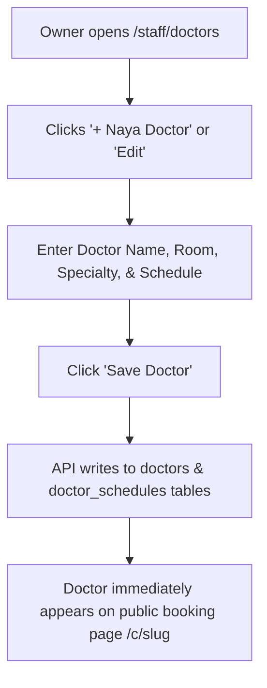

# Page Specification: Doctor Management & OPD Schedules

> Route: `/staff/doctors`
> Feature: F-016 Doctor Management (Owner; master; P0; roles: owner)
> Standard: `.claude/skills/uiux/references/page-standard.md`

---

## 1. Page overview

- **Purpose of the page:** Allow the clinic owner to manage the clinic's roster of consulting doctors, assign OPD specialties and consultation rooms, configure weekly OPD schedules (e.g. Monday–Friday 5:00 PM–9:00 PM), and set doctor-specific daily token quotas and consult duration averages.
- **The visitor it serves:** Clinic owner managing staff and schedules.
- **The one action it must drive:** Add a doctor or update a doctor's weekly OPD schedule.
- **PRD sections and IDs:** PRD §4 (Owner Navigation), §5.2, §5.3 (F-016 Doctor Management), §12.3 (doctors & doctor_schedules).
- **How a visitor arrives:** Clicks "Doctors & Schedules" from the owner navigation bar.

---

## 2. Section-by-section breakdown

1. **Header & Quick Stats:** Arrival & Overview. Active doctors count, assigned rooms, and "+ Naya Doctor Shamil Karein" CTA (`bg-surface`).
2. **Doctor Roster Grid:** Main Content. Interactive table or card grid displaying Doctor Name, Specialty, Assigned Room, Weekly Schedule, Status, and Actions (`bg-surface`).
3. **Doctor Profile & Schedule Modal / Drawer:** Configuration. Form to edit doctor details, weekly days (Mon–Sun toggles), start/end times, and daily quotas (`bg-surface-raised`).
4. **Deactivation & Leave Footnote:** Exception Management. Controls to mark a doctor on temporary leave or deactivate (`bg-surface-sunken`).

---

## 3. Content

- **Page Header:**
  - Title: "Doctor aur OPD Schedule (Doctors Management)"
  - Subtitle: "Clinic ke doctors, unke kamray aur rozana ke timings yahan manage karein."
  - Action Button: "+ Naya Doctor Shamil Karein / Add Doctor"
- **Roster Grid Column Titles & Sample Data:**
  - Col 1: "Doctor ka Naam" -> `Dr. Tariq Khan`
  - Col 2: "Specialty" -> `General Physician`
  - Col 3: "Kamra / Room" -> `Kamra No. 1`
  - Col 4: "Schedule" -> `Mon-Fri: 05:00 PM - 09:00 PM`
  - Col 5: "Daily Cap" -> `30 Tokens`
  - Col 6: "Status" -> `Active Badge`
  - Col 7: "Actions" -> `[Schedule Badlein] [Edit]`
- **Doctor Form Controls:**
  - Name Label: "Doctor ka Mukammal Naam *"
  - Name Placeholder: "e.g. Dr. Tariq Khan"
  - Specialty Label: "Specialty (Sho'ba) *"
  - Specialty Placeholder: "e.g. Child Specialist, General Physician"
  - Room Label: "Kamra Number (Room No) *"
  - Room Placeholder: "e.g. Room 1"
  - Weekly Days Selector: "[x] Mon [x] Tue [x] Wed [x] Thu [x] Fri [ ] Sat [ ] Sun"
  - Timings: "Start: 05:00 PM | End: 09:00 PM"
  - Doctor Token Cap: "Is Doctor ka Online Limit: [ 30 ]"
- **Primary CTA:**
  - Button Text: "Doctor Mehfooz Karein / Save Doctor"

---

## 4. Layout structure

- **Mobile Viewport (≤ 640px):** Single column card list showing doctor cards with direct "Edit Schedule" buttons. Add Doctor CTA pinned at top.
- **Tablet & Desktop Viewport (≥ 641px):** Full-width master data grid with action dropdowns; clicking edit opens a clean 640px center modal.

---

## 5. Component breakdown

1. `DoctorHeaderBar`: Top banner with total doctors count and primary add button. State: default. (Reuse).
2. `DoctorRosterTable`: Data table with weekly schedule badges and room numbers. State: loading skeleton, empty, default. (Reuse).
3. `WeeklyScheduleSelector`: Multi-select day pills (M, T, W, T, F, S, S) with time inputs. State: active, inactive. (New).
4. `DoctorFormModal`: Modal dialog for creating and editing doctor records. State: closed, open, saving. (New).

---

## 6. Visual hierarchy

1. **First:** "+ Naya Doctor Shamil Karein" high-contrast button in header.
2. **Second:** Doctor names and room numbers in the roster table.
3. **Third:** Active status badges and schedule summary chips.

---

## 7. CTAs

- **Primary CTA:**
  - Label: "+ Naya Doctor Shamil Karein"
  - Position: Header top-right.
  - Variant: `bg-accent text-fg-inverse hover:bg-accent-hover`.
  - Destination / Action: Opens `DoctorFormModal`.
- **Secondary Actions:**
  - "Schedule Badlein / Edit Schedule" (Opens schedule editor drawer).
  - "Ghair-faal Karein / Deactivate" (Soft deletes doctor record with confirmation).

---

## 8. Media

- **Stethoscope / Medical Icon:**
  - Purpose: Doctor card iconography.
  - Dimensions: 20px × 20px inline SVG.
- **3D / Heavy Assets:**
  - Not applicable — no 3D elements on this page. Pure lightweight DOM.

---

## 9. Interactions

- **Day Pill Toggle:** Tapping a day of the week highlights the pill with 120ms ease-out border and reveals time inputs for that day.
- **Modal Slide & Backdrop:** Add Doctor modal animates with 180ms ease-out backdrop fade and scale up.
- **Mobile Variant:** Full-width stacked layout with modal taking full screen for easy typing on touch screens.
- **Reduced-Motion Variant:** When `prefers-reduced-motion: reduce` is active, schedule toggles and modal appearance render instantaneously without scale or opacity transitions.

---

## 10. Diagram

```text
+--------------------------------------------------------------------------+
|  Doctor aur OPD Schedule (2 Active Doctors)      [+ Naya Doctor Shamil]  |
+--------------------------------------------------------------------------+
|  Doctor          | Specialty        | Room   | Schedule     | Cap | Act  |
|------------------+------------------+--------+--------------+-----+------|
|  Dr. Tariq Khan  | General Physician| Room 1 | Mon-Fri 5-9pm| 30  | [..] |
|  Dr. Ayesha Noor | Gynecologist     | Room 2 | Mon-Sat 6-9pm| 25  | [..] |
+--------------------------------------------------------------------------+
|  [ Modal - Doctor Schedule ]:                                            |
|  Doctor ka Naam: [ Dr. Tariq Khan                                     ]  |
|  Specialty:      [ General Physician ]  Room: [ Room 1                ]  |
|  Haftey ke Din:  [x] Mon  [x] Tue  [x] Wed  [x] Thu  [x] Fri  [ ] Sat    |
|  OPD Timing:     Start: [ 05:00 PM ]   End: [ 09:00 PM ]                 |
|  Online Cap:     [ 30 ] tokens rozana                                    |
|                                                                          |
|  [ Cancel ]                                   [=== Save Doctor =======]  |
+--------------------------------------------------------------------------+
```



---

## 11. Notes

- **Implementation Notes:** Strictly authorized to role `owner`. Deletion uses soft-delete (`deleted_at`); past visits and tokens linked to a deleted doctor remain intact in the database.
- **Performance Risks:** Grid must render immediately without delay.
- **Accessibility Notes:** Accessible day toggle checkboxes with clear visual and screen-reader states.
- **SEO Notes:** `title`: "Doctor Management — Clinic Owner", `noindex`: true.
