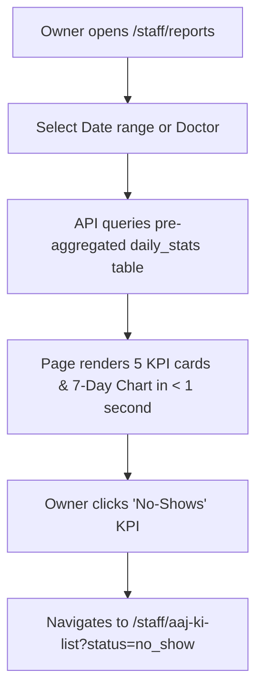

# Page Specification: Owner Daily Report & Dashboard

> Route: `/staff/reports`
> Features: F-010 Roz ki Report, D-001 Owner Dashboard (Owner; report; P1; roles: owner, doctor)
> Standard: `.claude/skills/uiux/references/page-standard.md`

---

## 1. Page overview

- **Purpose of the page:** The executive overview screen for clinic owners (and doctors for their own figures). Provides instant operational visibility into today's patient volume, average waiting times, consultation durations, no-show rates, online vs. walk-in ratios, and 7-day volume trends with one-click drill-downs to the underlying token lists.
- **The visitor it serves:** Clinic owner monitoring business performance on a mobile phone, tablet, or laptop.
- **The one action it must drive:** Inspect key clinic performance indicators and identify queue bottlenecks or peak hours.
- **PRD sections and IDs:** PRD §4 (Owner Navigation), §5.2, §5.3 (F-010, D-001), §7 (Dashboards), §9 (Reports R-001..R-004).
- **How a visitor arrives:** Clicks "Roz ki Report / Dashboard" from the owner navigation bar.

---

## 2. Section-by-section breakdown

1. **Dashboard Header & Date Filter:** Arrival & Configuration. Date picker (Today, Yesterday, Last 7 Days, Custom), doctor selector, and live sync timestamp (`bg-surface`).
2. **Key Metric KPI Cards (5 Cards):** High-level Overview. Clickable metric cards: Patients Seen, Avg Wait Time, No-Shows, Online vs Walk-in Ratio, and Avg Consultation Time (`bg-surface`).
3. **7-Day Patient Volume Trend Chart:** Trend Visualization. Clean Recharts line and bar graph depicting daily patient counts and wait trends (`bg-surface`).
4. **Doctor-by-Doctor Breakdown Table:** Comparative Analysis. Table comparing volume, average wait, and completion rates across all doctors (`bg-surface`).
5. **Report Actions & Export Bar:** Conversion & Utilities. Direct link to F-018 Daily Brief and CSV export button (`bg-surface-sunken`).

---

## 3. Content

- **Header Section:**
  - Screen Title: "Roz ki Report aur Dashboard (Daily Overview)"
  - Selected Range: "Aaj: 31 October 2026 (Shaam Tak)"
  - Doctor Filter: "Tamam Doctors (All Clinics Doctors)"
- **KPI Cards (Clickable Drill-downs):**
  - Card 1 (Patients Seen): Label "Kul Dekhe Gaye Mareez", Value "38", Trend "+12% vs pichla hafta", Filter Drill-down `status=done`
  - Card 2 (Avg Wait Time): Label "Average Intezaar (Wait)", Value "18 min", Trend "-4 min behtar", Filter Drill-down `avg_wait`
  - Card 3 (No-shows / Cancelled): Label "Aaye Nahi / Cancel", Value "4", Trend "8% no-show rate", Filter Drill-down `status=no_show`
  - Card 4 (Online vs Walk-in): Label "Online Booking Hissa", Value "68%", Subtext "26 Online / 12 Walk-in"
  - Card 5 (Consult Duration): Label "Average Doctor Waqt", Value "6.2 min", Subtext "Per consultation"
- **7-Day Volume Trend Chart:**
  - Chart Title: "Pichle 7 Din ka Volume (Tokens per Day)"
  - Chart Legend: "Online Tokens (Blue) | Walk-in Tokens (Neutral)"
  - Axis Labels: Date (X-axis), Token Count (Y-axis)
- **Doctor Performance Table:**
  - Col 1: "Doctor", Col 2: "Dekhe Gaye", Col 3: "Waiting Time", Col 4: "Consult Time", Col 5: "Online Share"
  - Row 1: "Dr. Tariq Khan" | "24" | "16 min" | "5.8 min" | "70%"
  - Row 2: "Dr. Ayesha Noor" | "14" | "21 min" | "6.9 min" | "64%"
- **Export & Brief CTA:**
  - Button Text: "Download CSV Report (R-002)"
  - Secondary Link: "AI Rozana Brief Dekhein (F-018) ->"

---

## 4. Layout structure

- **Mobile Viewport (≤ 640px):** Single column stack. 2x2 grid for top KPI cards, swipeable trend chart, collapsible doctor comparison table.
- **Tablet Viewport (641px–1024px):** 2-column dashboard layout with full-width trend chart.
- **Desktop Viewport (≥ 1025px):** 12-column grid. Top row hosts 5 KPI cards (2.4 cols each). Middle row hosts 7-day trend chart (8 cols) and Online/Walk-in Donut (4 cols). Bottom row hosts Doctor performance table.

---

## 5. Component breakdown

1. `ReportHeaderFilters`: Date range picker and doctor selector. State: default, loading. (Reuse).
2. `KPISummaryCard`: Clickable card with metric, percentage trend, and drill-down hover state. State: default, hover, active. (New).
3. `TrendBarChart`: Recharts responsive container with custom tooltip. State: loading skeleton, empty, loaded. (New).
4. `DoctorSummaryTable`: Dense performance grid. State: default, sorted. (Reuse).
5. `ExportButton`: Button triggering secure CSV stream download. State: default, downloading. (Reuse).

---

## 6. Visual hierarchy

1. **First:** Top row KPI figures ("38 Mareez Dekhe Gaye", "18 min Avg Wait") rendered in `--text-2xl` bold.
2. **Second:** 7-Day Trend Chart showing daily operational rhythm.
3. **Third:** Doctor comparison breakdown table at the bottom.

---

## 7. CTAs

- **Primary CTA:**
  - Label: "Download CSV Report (R-002)"
  - Position: Header top-right.
  - Variant: `bg-accent text-fg-inverse hover:bg-accent-hover`.
  - Destination / Action: Calls `GET /api/v1/reports/monthly.csv`.
- **Secondary Actions:**
  - "Drill Down to List" (Clicking any KPI card navigates to `/staff/aaj-ki-list` with applied filter).
  - "AI Daily Brief (F-018)" (Direct link to owner nightly narrative).

---

## 8. Media

- **Trend Chart Canvas:**
  - Purpose: Visual chart rendered with lightweight SVG via Recharts.
  - Aspect Ratio: 16:9 on mobile, 21:9 on desktop.
- **3D / Heavy Assets:**
  - Not applicable — no 3D elements on this page. Pure lightweight DOM.

---

## 9. Interactions

- **KPI Card Click Drill-down:** Clicking the "No-shows" card navigates immediately to `/staff/aaj-ki-list?status=no_show` with 150ms ease-out press feedback.
- **Chart Tooltip:** Hovering or tapping a chart bar reveals tooltip with exact patient count and wait time with 120ms fade.
- **Mobile Variant:** Optimized for phone screens (Owner Mobile Dashboard per PRD §29.6), cards stack into high-legibility vertical cards.
- **Reduced-Motion Variant:** When `prefers-reduced-motion: reduce` is active, chart renders immediately in its final state without bar height animation or tooltip fade transitions.

---

## 10. Diagram

```text
+--------------------------------------------------------------------------+
|  Roz ki Report & Dashboard (31-Oct-2026)         [ Download CSV Report ] |
|  Date: [ Aaj (Today) v ]      Doctor: [ Tamam Doctors                  v ]
+--------------------------------------------------------------------------+
| [ Dekhe Gaye ]  [ Avg Wait ]  [ No-Shows ]  [ Online Share ]  [ Consult ]|
|      38              18m           4              68%            6.2m    |
|   +12% vs wk      -4m better    8% rate        26 Online       per check |
+--------------------------------------------------------------------------+
|  7-DIN KA VOLUME TREND:                                                  |
|  [|||  Online  ||| Walk-in]                                              |
|  50 |          #                                                         |
|  40 |    #     #     #     #                                             |
|  30 |    #     #     #     #     #     #     #                           |
|  20 |    #     #     #     #     #     #     #                           |
|     +-----------------------------------------                           |
|       Mon   Tue   Wed   Thu   Fri   Sat   Sun                            |
+--------------------------------------------------------------------------+
|  DOCTOR BREAKDOWN:                                                       |
|  Doctor          | Dekhe Gaye | Avg Wait | Consult | Online Share        |
|  Dr. Tariq Khan  | 24         | 16 min   | 5.8 min | 70%                 |
|  Dr. Ayesha Noor | 14         | 21 min   | 6.9 min | 64%                 |
+--------------------------------------------------------------------------+
```



---

## 11. Notes

- **Implementation Notes:** Powered by the `daily_stats` table; heavy historical queries never lock live transactional token tables. Reception staff get 403 on this route; doctors see only their own data.
- **Performance Risks:** Must load under 1.0 second from pre-calculated stats.
- **Accessibility Notes:** Recharts charts include accessible data table fallback for screen readers.
- **SEO Notes:** `title`: "Daily Reports & KPIs — Clinic Owner", `noindex`: true.
