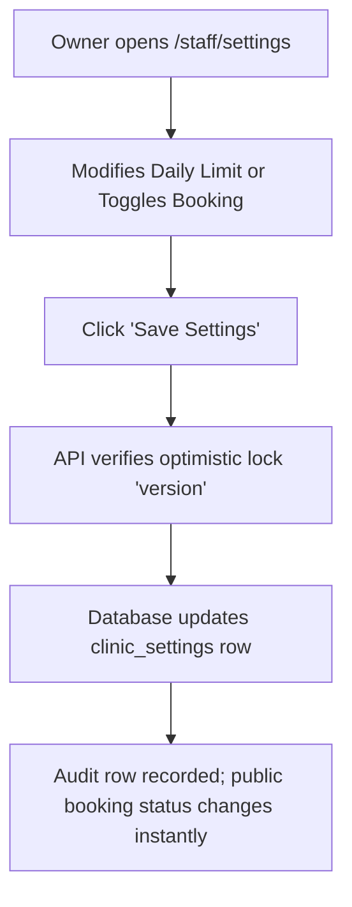

# Page Specification: Clinic Settings

> Route: `/staff/settings`
> Feature: F-011 Clinic Settings (Owner; settings; P0; roles: owner)
> Standard: `.claude/skills/uiux/references/page-standard.md`

---

## 1. Page overview

- **Purpose of the page:** Central configuration panel allowing the clinic owner to control clinic-wide operating rules without a software developer: toggle online booking on/off with one switch, set daily token quotas, configure OPD timings and consult duration averages, and enable patient advice sharing and AI consent features.
- **The visitor it serves:** Clinic owner managing clinic operational parameters.
- **The one action it must drive:** Update settings and click "Settings Mehfooz Karein / Save Settings".
- **PRD sections and IDs:** PRD §4 (Owner Navigation), §5.2, §5.3 (F-011 Clinic Settings), §14.3 (Data Privacy & AI Consent).
- **How a visitor arrives:** Clicks "Clinic Settings" from the owner navigation menu.

---

## 2. Section-by-section breakdown

1. **Header & Fast Emergency Switch:** Arrival & Core Control. Prominent master toggle: "Online Token Booking On / Off" (`bg-surface`).
2. **Quota & Advance Booking Section:** Capacity Limits. Controls for Daily Online Token Limit and Days in Advance allowed (`bg-surface`).
3. **Queue & OPD Operation Section:** Clinical Configuration. Average consult duration in minutes and "Call only arrived patients" rule toggle (`bg-surface`).
4. **Patient Advice Sharing (F-021 Setting):** Feature Toggle. Switch: "Mareez ko dawa aur hidayat link par dikhayein" (`bg-surface`).
5. **AI Features & Privacy Consent:** Advanced & Regulatory. Switch: "AI ko mareez ke notes istemal karne dein" with consent modal trigger (`bg-surface-sunken`).
6. **Action Bar:** Primary Conversion. Save Settings button and optimistic concurrency conflict handler (`bg-surface`).

---

## 3. Content

- **Header Section:**
  - Title: "Clinic Settings (Kawaif o Zabt)"
  - Subtitle: "Clinic ke token rules, timing aur AI settings yahan se set karein."
- **Emergency Booking Switch:**
  - Label: "Online Token Booking Status"
  - Switch Description: "Is switch ko band karne se public booking page band ho jayega."
  - Current State: "[ON] Booking Khuli Hai (Patients can book)"
- **Token Quota Settings:**
  - Limit Label: "Rozana Online Token Limit (Daily Cap) *"
  - Limit Value: "30 tokens rozana per doctor"
  - Advance Booking Label: "Kitne Din Pehle Booking Khule? *"
  - Advance Booking Options: "Sirf Aaj (Today only) | Aaj aur Kal (Today + Tomorrow)"
- **OPD Timing & Operation Rules:**
  - Consult Minutes Label: "Doctor ka Average Consult Waqt (Minutes) *"
  - Consult Minutes Helper: "Is waqt se mareez ko andaazan time calculate hota hai (Default: 6 min)."
  - Arrived Only Rule: "[x] Sirf un mareezon ka number aaye jo clinic pohnch chuke hon (Call only arrived)"
- **Patient Advice & AI Settings:**
  - Share Advice Label: "Mareez ko Dawa aur Hidayat Dikhayein (F-021) *"
  - Share Advice Helper: "Band hone par visit advice mareez ke token link par nahi dikhegi."
  - AI Notes Consent: "[ ] AI ko visit notes summary ke liye istemal karne dein (Q-004)"
  - AI Consent Subtext: "Default: OFF. On karne se pehle consent lazmi hai."
- **Primary CTA:**
  - Button Text: "Settings Mehfooz Karein / Save Settings"

---

## 4. Layout structure

- **Mobile Viewport (≤ 640px):** Single column, touch-friendly 44px toggle switches, full-width save button sticky at bottom.
- **Tablet & Desktop Viewport (≥ 641px):** Centered master form container, max-width 960px (`--layout-form-max`), structured into 4 clean cards with 16px vertical gap.

---

## 5. Component breakdown

1. `SettingsCardShell`: PRD-mandated form layout shell. State: default. (Reuse).
2. `SwitchToggleControl`: Accessible toggle switch with color indicator. State: ON (emerald), OFF (neutral). (Reuse).
3. `NumberStepperInput`: Numeric field with + / - buttons. State: default, focus, min/max bounded. (Reuse).
4. `AIConsentDialog`: Formal modal dialog explaining data handling before enabling AI. State: closed, open, accepted. (New).
5. `SaveSettingsBar`: Pinned bottom bar with dirty state detection. State: clean, dirty, saving, saved toast. (Reuse).

---

## 6. Visual hierarchy

1. **First:** Emergency Master Switch ("Online Token Booking ON/OFF") at the very top.
2. **Second:** Daily Quota number input field ("30 tokens per doctor").
3. **Third:** High-contrast blue "Save Settings" button at the bottom.

---

## 7. CTAs

- **Primary CTA:**
  - Label: "Settings Mehfooz Karein / Save Settings"
  - Position: Pinned right in bottom action bar.
  - Variant: `bg-accent text-fg-inverse hover:bg-accent-hover`.
  - Destination / Action: Calls `PUT /api/v1/settings` with payload and optimistic lock `version`.
  - Success State: Shows success toast: "Settings kamyabi se update ho gayi hain."
- **Secondary Actions:**
  - "Mansookh Karein / Discard Changes" (Resets form to initial server state).

---

## 8. Media

- **Settings Icons:**
  - Purpose: Visual categorisation of settings sections (Sliders, Clock, Shield icons).
  - Dimensions: 20px × 20px inline SVGs.
- **3D / Heavy Assets:**
  - Not applicable — no 3D elements on this page. Pure lightweight DOM.

---

## 9. Interactions

- **Master Toggle Tap:** Flipping the Online Booking switch updates immediately with 120ms slide ease-out and displays a prominent warning pill if turned OFF.
- **AI Consent Trigger:** Checking "AI Notes Enabled" opens the legal consent confirmation modal before state can change.
- **Mobile Variant:** Full-width mobile layout with sticky bottom save button and touch-friendly switches.
- **Reduced-Motion Variant:** When `prefers-reduced-motion: reduce` is active, toggle switches snap between states with zero sliding animation.

---

## 10. Diagram

```text
+--------------------------------------------------------------------------+
|  Clinic Settings (Aapka Family Clinic)             [ Save Settings ]     |
+--------------------------------------------------------------------------+
|  EMERGENCY MASTER TOGGLE:                                                |
|  Online Token Booking Status:        [ (o) ON - Booking Khuli Hai ]      |
|  Notice: Off karne se public booking foran band ho jayegi.               |
+--------------------------------------------------------------------------+
|  QUOTA AUR TIMING:                                                       |
|  Rozana Online Limit:    [ 30 ] tokens per doctor                        |
|  Advance Booking:        (o) Sirf Aaj    ( ) Aaj aur Kal                 |
|  Avg Consult Duration:   [ 6 ] minute per patient                        |
|  [x] Sirf arrived mareezon ko call karein                                |
+--------------------------------------------------------------------------+
|  MAREEZ ADVICE & AI CONSENT:                                             |
|  Mareez ko Hidayat Dikhayein (F-021):  [ (o) ON - Shared Advice Active ] |
|  AI Notes Summarizer Consent:          [ ( ) OFF - Disabled (Q-004) ]   |
+--------------------------------------------------------------------------+
|  [ Discard ]                                  [=== Save Settings =======]|
+--------------------------------------------------------------------------+
```



---

## 11. Notes

- **Implementation Notes:** Strictly authorized to role `owner`. Optimistic concurrency via `version int` prevents accidental overwrite if two owners save simultaneously.
- **Performance Risks:** Settings changes invalidate cached clinic public metadata within 1 second.
- **Accessibility Notes:** Semantic `<label>` elements connected via `for`/`id`. Screen reader announces switch state as "Checked / Not Checked".
- **SEO Notes:** `title`: "Clinic Settings — Owner", `noindex`: true.
