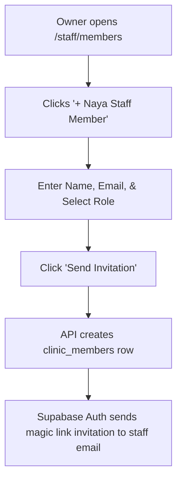

# Page Specification: Staff & Member Management

> Route: `/staff/members`
> Feature: F-015 Staff Management (Owner; master; P0; roles: owner)
> Standard: `.claude/skills/uiux/references/page-standard.md`

---

## 1. Page overview

- **Purpose of the page:** Allow clinic owners to manage clinic staff accounts: invite receptionists, associate doctors with system user accounts, assign roles (`reception`, `doctor`, `owner`), and deactivate departed staff members to immediately revoke magic link access.
- **The visitor it serves:** Clinic owner managing team permissions.
- **The one action it must drive:** Invite a new staff member via email or update a team member's role.
- **PRD sections and IDs:** PRD §4 (Owner Navigation), §5.2, §5.3 (F-015 Staff Management), §14.2 (Role & Permission Matrix).
- **How a visitor arrives:** Clicks "Staff & Roles" from the owner navigation bar.

---

## 2. Section-by-section breakdown

1. **Header & Active Staff Count:** Arrival & Overview. Active staff count, role distribution summary, and "+ Naya Staff Shamil Karein" button (`bg-surface`).
2. **Staff Members Directory Table:** Main Content. Interactive table displaying Member Name, Email (Login ID), Assigned Role Badge, Doctor Association, Status, and Actions (`bg-surface`).
3. **Invite Staff Member Modal:** Configuration. Form to invite staff by email, set full name, phone number, and assign role permissions (`bg-surface-raised`).
4. **Role Permissions Explanation Footnote:** Guidance. Short explanatory legend clarifying what `reception`, `doctor`, and `owner` roles can access (`bg-surface-sunken`).

---

## 3. Content

- **Page Header:**
  - Title: "Staff aur Roles (Staff Management)"
  - Subtitle: "Receptionists aur Doctors ko email link ke zariye invite karein."
  - Action Button: "+ Naya Staff Member / Invite Staff"
- **Staff Table Column Titles & Sample Data:**
  - Col 1: "Naam" -> `Muhammad Bilal`
  - Col 2: "Login Email" -> `bilal.reception@clinic.com`
  - Col 3: "Role" -> `Reception Badge (Blue)`
  - Col 4: "Linked Doctor" -> `None (Desk)`
  - Col 5: "Status" -> `Active Badge (Green)`
  - Col 6: "Actions" -> `[Role Badlein] [Deactivate]`
- **Invite Staff Form Controls:**
  - Name Label: "Staff Member ka Naam *"
  - Name Placeholder: "e.g. Muhammad Bilal"
  - Email Label: "Staff ka Login Email *"
  - Email Placeholder: "bilal@gmail.com ya clinic staff email"
  - Email Helper: "Is email par staff ka login magic link bheja jayega."
  - Phone Label: "Mobile Number (Rabtey ke liye) *"
  - Phone Placeholder: "0300 1234567"
  - Role Selector: "Role Chunein: Receptionist | Doctor | Co-Owner"
  - Doctor Association (if Doctor): "Konsay Doctor hain? [ Dr. Tariq Khan v ]"
- **Primary CTA:**
  - Button Text: "Dawat Bhejein / Send Invitation"

---

## 4. Layout structure

- **Mobile Viewport (≤ 640px):** Single column card list, each staff card showing name, email, role badge, and action overflow menu. Invite button pinned at top.
- **Tablet & Desktop Viewport (≥ 641px):** Full-width master data grid with clear role badges; clicking Invite opens 540px centered modal.

---

## 5. Component breakdown

1. `StaffHeaderBar`: Header with member count and invite button. State: default. (Reuse).
2. `StaffMembersTable`: Grid component displaying roles, emails, and active toggles. State: loading skeleton, empty, default. (Reuse).
3. `RoleBadge`: Color-coded pill badge (Reception = Info blue, Doctor = Violet, Owner = Amber). State: default. (Reuse).
4. `InviteStaffModal`: Form modal for dispatching invitations. State: closed, open, sending. (New).

---

## 6. Visual hierarchy

1. **First:** "+ Naya Staff Member" primary button in header.
2. **Second:** Staff member email addresses and role badges in the table.
3. **Third:** Active status pills and deactivation actions.

---

## 7. CTAs

- **Primary CTA:**
  - Label: "+ Naya Staff Member / Invite Staff"
  - Position: Header top-right.
  - Variant: `bg-accent text-fg-inverse hover:bg-accent-hover`.
  - Destination / Action: Opens `InviteStaffModal`.
- **Secondary Actions:**
  - "Role Badlein / Change Role" (Opens role update select).
  - "Ghair-faal Karein / Deactivate" (Revokes access immediately with confirmation).

---

## 8. Media

- **Role Icons:**
  - Purpose: Visual icon for staff roles (Desk, Stethoscope, Crown).
  - Dimensions: 16px × 16px SVGs.
- **3D / Heavy Assets:**
  - Not applicable — no 3D elements on this page. Pure lightweight DOM.

---

## 9. Interactions

- **Role Select Change:** Changing role dynamically reveals or hides the "Linked Doctor" dropdown with 150ms ease-out expand.
- **Deactivation Confirm:** Clicking deactivate triggers an alert dialog naming the user and confirming magic links will cease functioning.
- **Mobile Variant:** Full-width stacked cards with quick-call and action buttons.
- **Reduced-Motion Variant:** When `prefers-reduced-motion: reduce` is active, modal and dropdown reveals render without slide or expand animations.

---

## 10. Diagram

```text
+--------------------------------------------------------------------------+
|  Staff aur Roles (4 Team Members)                 [+ Naya Staff Member]  |
+--------------------------------------------------------------------------+
|  Naam          | Login Email           | Role       | Doctor   | Status  |
|----------------+-----------------------+------------+----------+---------|
|  Dr. Tariq     | tariq@clinic.com      | Doctor     | Dr. Tariq| Active  |
|  M. Bilal      | bilal@clinic.com      | Reception  | -        | Active  |
|  Sana Javed    | sana@clinic.com       | Reception  | -        | Active  |
|  Haji Aslam    | aslam.owner@gmail.com | Owner      | -        | Active  |
+--------------------------------------------------------------------------+
|  [ Modal - Invite Staff Member ]:                                        |
|  Mukammal Naam: [ Muhammad Bilal                                      ]  |
|  Login Email:   [ bilal.reception@clinic.com                          ]  |
|  Role:          (o) Receptionist   ( ) Doctor   ( ) Co-Owner             |
|                                                                          |
|  [ Cancel ]                                   [=== Dawat Bhejein =====]  |
+--------------------------------------------------------------------------+
```



---

## 11. Notes

- **Implementation Notes:** Strictly authorized to role `owner`. Every role change and member deactivation writes an audit row to `audit_logs`.
- **Performance Risks:** Grid renders immediately.
- **Accessibility Notes:** Accessible table markup with ARIA roles on action buttons.
- **SEO Notes:** `title`: "Staff Management — Clinic Owner", `noindex`: true.
