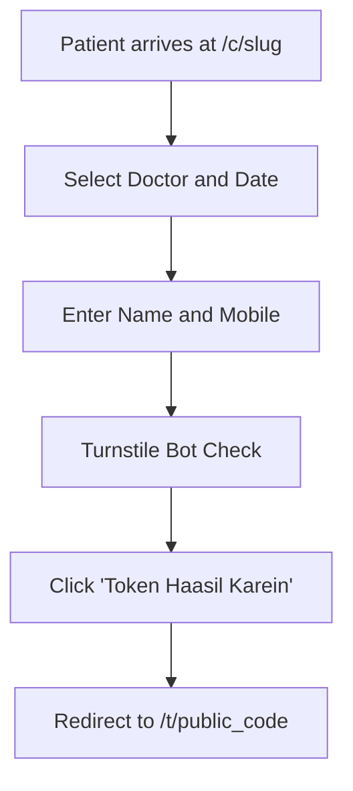

# Page Specification: Public Token Booking

> Route: `/c/{clinic-slug}`
> Feature: F-001 Token Booking (Patient; transaction; P0; role: public)
> Standard: `.claude/skills/uiux/references/page-standard.md`

---

## 1. Page overview

- **Purpose of the page:** Allow patients or their relatives to book an OPD queue token from home via a shared link or QR code in under 60 seconds without installing an app or logging in.
- **The visitor it serves:** Patients seeking medical consultation, often accessing via a smartphone on mobile data (2G/3G/4G).
- **The one action it must drive:** Tap "Token Haasil Karein / Get Token" to generate a live queue token.
- **PRD sections and IDs:** PRD §4 (Public Navigation), §5.2, §5.3 (F-001 Token Booking), §10 (W-001 Patient Booking Flow).
- **How a visitor arrives:** Clicks a clinic WhatsApp link, scans a printed QR code at the clinic entrance, or opens a shared clinic URL (`/c/{clinic-slug}`).

---

## 2. Section-by-section breakdown

1. **Clinic Header Banner:** Arrival & Identity. Displays clinic name, address, and live status indicator (`bg-surface`).
2. **Doctor & Schedule Selector:** Explanation & Configuration. Card selector for available doctor, OPD timing, and consultation date (Today / Tomorrow) (`bg-surface`).
3. **Patient Details Form:** Conversion. Compact form requesting Patient Name, Mobile Number, and optional Gender (`bg-surface`).
4. **Anti-Bot & Quota Summary:** Verification & Reassurance. Turnstile challenge and remaining token quota notice (`bg-surface-sunken`).
5. **Sticky Action Bar:** Primary Conversion. Full-width primary CTA button (`bg-surface`).

---

## 3. Content

- **Clinic Header:**
  - Clinic Name: "Aapka Family Clinic"
  - Address / Landmark: "Main Market, Sector G-9/1, Islamabad"
  - OPD Timings: "Shaam 05:00 PM se 09:00 PM tak"
  - Online Booking Status: "Online Token Khula Hai (Active)"
- **Doctor & Date Section:**
  - Section Heading: "Doctor aur Tareekh Chunein"
  - Doctor Label: "Doctor ka Naam"
  - Doctor Value: "Dr. Tariq Khan (General Physician — Room 1)"
  - Date Selection: "Tareekh: Aaj (Today) | Kal (Tomorrow)"
  - Tokens Left Notice: "Aaj ke sirf 8 online tokens baqi hain"
- **Patient Details Section:**
  - Section Heading: "Mareez ki Maloomat"
  - Name Label: "Mareez ka Mukammal Naam *"
  - Name Placeholder: "e.g. Muhammad Ali"
  - Phone Label: "Mobile Number (WhatsApp) *"
  - Phone Placeholder: "0300 1234567"
  - Phone Helper Text: "Token ka link aur update is number par dastiyab hoga."
- **Primary CTA:**
  - Button Text: "Token Haasil Karein / Get Token"
  - Subtext: "Bila-muavza (Free online token)"

---

## 4. Layout structure

- **Mobile Viewport (≤ 640px):** Single column, 100% width, container padding 16px (`p-4`), gap between cards 12px. Sticky bottom CTA bar with 16px safe-area padding.
- **Tablet Viewport (641px–1024px):** Centered card shell, max-width 540px, padding 24px (`p-6`), 16px vertical gap.
- **Desktop Viewport (≥ 1025px):** Centered card shell, max-width 480px, elevation `--shadow-md`, surrounded by neutral canvas `--color-canvas`.

---

## 5. Component breakdown

1. `ClinicHeaderCard`: Clinic branding, address, verified badge. State: default, loading skeleton. (New).
2. `DoctorSelectCard`: Radio card group for active doctors. State: default, selected (`ring-2 ring-accent`), disabled when quota exhausted. (New).
3. `DatePickerPills`: Today / Tomorrow toggle pills. State: active (`bg-accent text-fg-inverse`), inactive (`bg-surface border`). (New).
4. `FormFieldInput`: Text and phone inputs. State: default, focus (`ring-2 ring-border-focus`), error (`border-danger text-danger`), disabled. (Reuse).
5. `TurnstileWidget`: Cloudflare verification box. State: loading, verified, expired. (New).
6. `StickyActionButton`: Bottom-pinned primary button. State: default, loading (spinner), disabled. (Reuse).

---

## 6. Visual hierarchy

1. **First:** Clinic Name and Online Booking Status pill at the top of the viewport.
2. **Second:** Doctor selector and remaining token count ("8 online tokens baqi hain").
3. **Third:** High-contrast blue primary CTA button "Token Haasil Karein" pinned at the bottom.

---

## 7. CTAs

- **Primary CTA:**
  - Label: "Token Haasil Karein / Get Token"
  - Position: Pinned to viewport bottom on mobile; bottom of form on desktop.
  - Variant: `bg-accent text-fg-inverse hover:bg-accent-hover`.
  - Destination / Action: Submits `POST /api/v1/public/clinics/{slug}/tokens`.
  - Success State: Redirects immediately to `/t/{public_code}` (F-002 Token Confirm).
- **Secondary Actions:**
  - "Doctor badlein" (Clear doctor selection).

---

## 8. Media

- **Clinic Logo:**
  - Purpose: Clinic brand recognition above the fold.
  - Aspect Ratio: 1:1 circular badge (48px × 48px).
  - Max Bytes: ≤ 15 KB (WebP).
  - Alt Text: "Clinic logo".
  - Loading: Priority `eager` above the fold.
- **3D / Heavy Assets:**
  - Not applicable — no 3D elements on this page. Pure lightweight DOM.

---

## 9. Interactions

- **Doctor Selection Tap:** Radio card highlights with 120ms ease-out border transition.
- **Phone Input Formatting:** Automatically formats Pakistani mobile numbers into `03XX XXXXXXX` format.
- **Form Submission:** Button shows loading spinner, prevents double-clicks (`aria-busy="true"`).
- **Mobile Variant:** Full-width sticky action bar with bottom navigation safe-inset (`env(safe-area-inset-bottom)`).
- **Reduced-Motion Variant:** When `prefers-reduced-motion: reduce` is active, selection border and button transitions render instantaneously without ease curves or scale pulses.

---

## 10. Diagram

```text
+------------------------------------------+
|  [Logo] Aapka Family Clinic     (Active) |
|  Main Market, Sector G-9/1, Islamabad   |
+------------------------------------------+
|  Doctor aur Tareekh                      |
|  (o) Dr. Tariq Khan (General Physician)  |
|  [ Aaj (Today) ]  [ Kal (Tomorrow) ]     |
|  Notice: 8 online tokens baqi hain       |
+------------------------------------------+
|  Mareez ki Maloomat                      |
|  Naam:   [ Muhammad Ali                ] |
|  Mobile: [ 0300 1234567                ] |
+------------------------------------------+
|  [x] Cloudflare Turnstile Verification   |
+------------------------------------------+
|  [==== Token Haasil Karein (Free) =====] |
+------------------------------------------+
```



---

## 11. Notes

- **Implementation Notes:** Public route. Does not require staff authentication. Rate limited to 5 bookings per minute per IP and 3 bookings per day per phone number.
- **Performance Risks:** Must load under 100 KB total JS so 2G mobile connections render in < 2 seconds.
- **Accessibility Notes:** Form labels linked to inputs via `htmlFor`. Error messages use `aria-describedby` and `role="alert"`.
- **SEO Notes:** `title`: "Book Online OPD Token — Aapka Clinic", `noindex`: false (public clinic landing).
