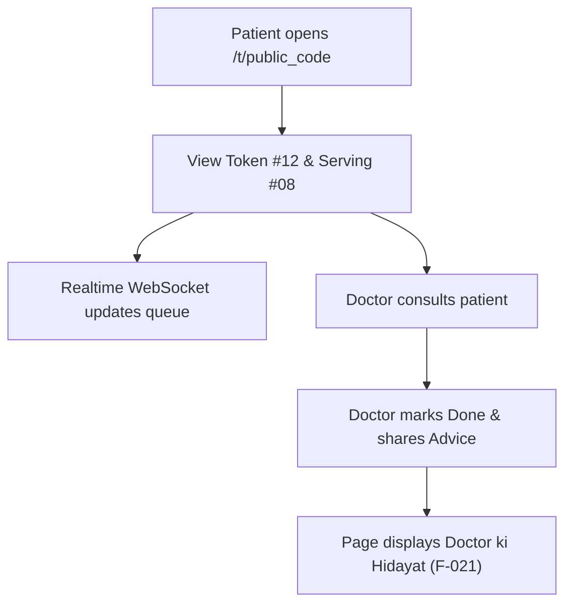

# Page Specification: Public Token & Live Queue

> Route: `/t/{public-code}`
> Features: F-002 Token Confirm, F-003 Live Queue, F-019 Patient Chat Assistant, F-021 Doctor ki Hidayat
> Standard: `.claude/skills/uiux/references/page-standard.md`

---

## 1. Page overview

- **Purpose of the page:** The permanent single-link destination for the patient. Shows immediate booking confirmation, real-time live queue progress ("Aap ka number", "Abhi chal raha number", "Aap se aage log", "Andaazan waqt"), an integrated Roman Urdu AI chat assistant, and post-visit doctor advice when enabled.
- **The visitor it serves:** The patient or guardian waiting at home or in the clinic waiting area.
- **The one action it must drive:** Monitor queue position in real-time and arrive at the clinic when 3–4 patients remain ahead.
- **PRD sections and IDs:** PRD §4 (Public Navigation), §5.2, §5.3 (F-002, F-003, F-019, F-021), §10 (W-002 Live Queue Tracking), §36.10 (Patient Chat).
- **How a visitor arrives:** Redirected after booking at `/c/{slug}`, opens a saved bookmark, or taps the SMS/WhatsApp link.

---

## 2. Section-by-section breakdown

1. **Token Confirmation Card:** Arrival & Reassurance. Large hero display of patient's issued token number, estimated call time, and status badge (`bg-surface`).
2. **Live Queue Pulse Grid:** Status & Continuity. High-contrast 2x2 metric grid: Current Serving Token, Tokens Ahead, Estimated Wait Time, Doctor Room (`bg-surface`).
3. **Queue Progress Bar:** Spatial Explanation. Visual stepped bar depicting queue movement from Start to Patient Turn (`bg-surface`).
4. **Action & Utilities Strip:** Secondary Tasks. Cancel token button, directions map link, and refresh toggle (`bg-surface-sunken`).
5. **Doctor Advice Section (F-021):** Post-Visit Care. Shows prescribed medicines and care instructions after consultation (`bg-surface`).
6. **Patient AI Assistant Drawer (F-019):** Support. Embedded Roman Urdu chat interface answering "Mera number kab aayega?", "Clinic ki timing kya hai?" (`bg-surface`).

---

## 3. Content

- **Hero Token Card:**
  - Clinic Name: "Aapka Family Clinic"
  - Doctor Name: "Dr. Tariq Khan (Room 1)"
  - Hero Label: "Aap ka Token Number"
  - Hero Token Number: "#12"
  - Patient Name: "M. Ali"
  - Booking Date: "Aaj (Today) — Shaam OPD"
  - Token Status Badge: "Tohfeeq Shuda / Confirmed"
- **Live Queue Grid:**
  - Box 1 (Now Serving): Label "Abhi Chal Raha Number", Value "#08", Status "Doctor ke paas"
  - Box 2 (People Ahead): Label "Aap se Aage", Value "3 Mareez", Subtext "Clinic rawana ho jayein"
  - Box 3 (Est Wait): Label "Andaazan Intezaar", Value "~18 Minute", Subtext "Avg 6 min/patient"
  - Box 4 (OPD Status): Label "OPD Haalat", Value "Jaari Hai (Live)", Subtext "Realtime connected"
- **Doctor ki Hidayat (F-021 — Visible post-visit):**
  - Section Heading: "Doctor ki Hidayat aur Dawa (Advice)"
  - Notice: "Yeh hidayat 30 din tak dastiyab rahegi."
  - Advice Body: "Subah sham pani zyada piyein, Panadol 500mg zarurat ke waqt 1 goli."
- **AI Chat Assistant (F-019):**
  - Trigger Pill: "Sawal Poochein (AI Assistant) — 'Mera number kab aayega?'"
  - Chat Title: "Clinic Madadgar (Roman Urdu / English)"
  - Welcome Message: "Assalam-o-Alaikum! Main Aapka Clinic ka AI assistant hoon. Aap mujh se apne token aur bari ke mutaliq pooch sakte hain."
  - Input Placeholder: "Apna sawal likhein (e.g. kitni der baqi hai?)..."

---

## 4. Layout structure

- **Mobile Viewport (≤ 640px):** Single column vertical stack, 100% width, container padding 16px (`p-4`), card spacing 12px. Sticky bottom floating bar for AI Chat trigger and Refresh button.
- **Tablet Viewport (641px–1024px):** Centered layout, max-width 560px, padding 20px (`p-5`).
- **Desktop Viewport (≥ 1025px):** Centered card shell, max-width 500px, elevation `--shadow-md`, canvas background `--color-canvas`.

---

## 5. Component breakdown

1. `HeroTokenDisplay`: High-impact token number `#12` in mono font with color-coded status. State: default, arrived, serving, done, cancelled. (New).
2. `LiveQueueMetricCard`: 4-cell metric box. State: default, live pulse on data update. (New).
3. `ProgressBarTracker`: Step progress indicating queue advancement. State: default, animated fill. (New).
4. `DoctorAdviceCard`: Post-visit medicine and dietary instructions card. State: hidden during queue, visible once visit is completed and shared. (New).
5. `AIChatDrawer`: Bottom-sheet modal chat interface. State: collapsed pill, expanded drawer, sending message, bot typing. (New).
6. `CancelTokenDialog`: Confirmation alert modal before voiding token. State: hidden, open, confirming. (Reuse).

---

## 6. Visual hierarchy

1. **First:** Patient's issued token number (`#12`) rendered in `--text-3xl` bold monospace.
2. **Second:** Currently serving token (`#08`) and people ahead ("3 Mareez") in high-contrast card cells.
3. **Third:** Estimated remaining time banner ("~18 Minute — Clinic rawana ho jayein").

---

## 7. CTAs

- **Primary CTA:**
  - Label: "Sawal Poochein (Ask AI)"
  - Position: Floating pill at bottom of screen.
  - Variant: `bg-accent text-fg-inverse rounded-full shadow-md`.
  - Destination / Action: Opens `AIChatDrawer`.
- **Secondary Actions:**
  - "Token Mansookh Karein / Cancel Token" (Red ghost button opens confirmation dialog).
  - "Rasta Dekhein / Clinic Directions" (Opens Google Maps link).
  - "Taaza Karein / Refresh" (Manual queue re-sync button).

---

## 8. Media

- **Live Pulse Dot:**
  - Purpose: Visual cue of active Supabase Realtime broadcast connection.
  - Dimensions: 8px × 8px emerald circle (`bg-success animate-pulse`).
  - Loading: Inline SVG / CSS.
- **3D / Heavy Assets:**
  - Not applicable — no 3D elements on this page. Pure lightweight DOM.

---

## 9. Interactions

- **Realtime Queue Increment:** When doctor presses NEXT, the "Now Serving" token transitions vertically with a 180ms ease-out flip (`translateY(-4px)` to `0`) and the "People Ahead" count updates automatically without reloading.
- **Chat Drawer Slide:** Chat drawer slides up from screen bottom with 240ms cubic-bezier transition.
- **Mobile Variant:** Full-width layout, touch-friendly 44px tap targets for chat and cancel actions.
- **Reduced-Motion Variant:** When `prefers-reduced-motion: reduce` is detected, token number updates change text instantly with zero transforms or pulse animations.

---

## 10. Diagram

```text
+------------------------------------------+
|  [Logo] Aapka Family Clinic     (o) Live |
|  Dr. Tariq Khan - Room 1                 |
+------------------------------------------+
|           AAP KA TOKEN NUMBER            |
|                  #12                     |
|            M. Ali (Confirmed)            |
+------------------------------------------+
|  Abhi Chal Raha    |  Aap se Aage        |
|  #08 (In Room)     |  3 Mareez           |
|--------------------+---------------------|
|  Andaazan Intezaar |  OPD Haalat         |
|  ~18 Minute        |  Jaari Hai          |
+------------------------------------------+
|  [================ 65% =================]|
|  Notice: Jab 3 mareez baqi hon to pohnchein|
+------------------------------------------+
|  [ Mansookh Karein ]   [ Clinic Map ]    |
+------------------------------------------+
|       ( ? Sawal Poochein - AI Chat )     |
+------------------------------------------+
```



---

## 11. Notes

- **Implementation Notes:** Server-renders initial token and queue status for instant LCP; subscribes to Supabase Realtime channel `queue:{clinic_id}:{doctor_id}` in client island.
- **Performance Risks:** Bundle must remain strictly under 95 KB gzip so budget Android phones load the queue within 1.5 seconds on 3G.
- **Accessibility Notes:** Queue updates announce changes to screen readers using `aria-live="polite"`.
- **SEO Notes:** `title`: "Live Queue Token #12 — Aapka Clinic", `noindex`: true (private unguessable token link).
