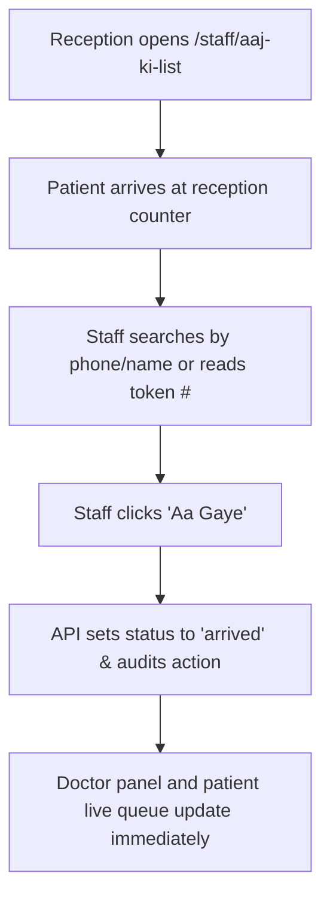

# Page Specification: Reception Day List (Aaj ki List)

> Route: `/staff/aaj-ki-list`
> Feature: F-004 Aaj ki List (Reception; list; P0; roles: reception, owner, doctor (own))
> Standard: `.claude/skills/uiux/references/page-standard.md`

---

## 1. Page overview

- **Purpose of the page:** The daily mission-control screen for clinic reception. Replaces the paper register with a live, real-time list of all tokens for the day (both online bookings and walk-ins), enabling staff to filter by status, search by patient name/phone, and mark patients as arrived.
- **The visitor it serves:** Clinic receptionists managing check-ins, answering counter queries, and coordinating queue flow.
- **The one action it must drive:** Mark arriving patients as "Arrived / Aa Gaye" and track queue movement.
- **PRD sections and IDs:** PRD §4 (Reception Navigation), §5.2, §5.3 (F-004 Aaj ki List), §10 (W-003 Patient Arrival Flow).
- **How a visitor arrives:** Reception staff signs in and is directed to `/staff/aaj-ki-list` by default.

---

## 2. Section-by-section breakdown

1. **Header & Status Bar:** Arrival & Overview. Shows clinic name, current date, active doctor selector, and summary counts (`bg-surface`).
2. **Quick Metric Chips:** Status Summary. Clickable pills showing count of: Total Tokens, Booked, Arrived, Serving, Done, and No-Show (`bg-surface`).
3. **Filter & Search Toolbar:** Data Controls. Real-time patient search (name/phone), doctor dropdown, source filter (Online / Walk-in), and status tabs (`bg-surface-sunken`).
4. **Token Data Grid / Card List:** Main Content. Interactive list displaying Token #, Patient Name, Phone, Source, Time, Status Badge, and Action buttons (`bg-surface`).
5. **Sticky Action Bar:** Primary Conversion. Quick shortcut button to "+ Naya Walk-in Mareez (F-005)" (`bg-surface`).

---

## 3. Content

- **Page Header:**
  - Screen Title: "Aaj ki List — Daily Token Queue"
  - Date Indicator: "Aaj: 31 October 2026 (Shaam OPD)"
  - Doctor Selector: "Tamam Doctors (All) | Dr. Tariq Khan | Dr. Ayesha Noor"
- **Summary Metrics:**
  - Total Tokens: "Kul Tokens: 42"
  - Serving: "Chal Raha: #08"
  - Arrived: "Aa Gaye: 14"
  - Online Booked: "Online: 28"
  - Walk-in: "Walk-in: 14"
- **Search & Filters:**
  - Search Placeholder: "Mareez ka naam ya phone number likhein (Search)..."
  - Status Filter Tabs: "Tamam (42) | Arrived (14) | Serving (1) | Booked (12) | Done (15)"
- **Grid Column Titles & Sample Data:**
  - Col 1: "Token #" -> `#08`, Col 2: "Mareez ka Naam" -> `Muhammad Ali`, Col 3: "Phone" -> `0300 1234567`, Col 4: "Source" -> `Online Badge`, Col 5: "Waqt" -> `06:30 PM`, Col 6: "Status" -> `Serving Badge`, Col 7: "Actions" -> `[Aa Gaye] [Mansookh]`
- **Primary CTA:**
  - Button Text: "+ Naya Walk-in Token (F-005)"

---

## 4. Layout structure

- **Mobile Viewport (≤ 640px):** Dense card list view, each card showing large Token #, patient name, arrival button, and status badge. Search bar sticky at top.
- **Tablet Viewport (641px–1024px):** Responsive data table with compact row heights (`--grid-row-compact: 28px`), horizontal scroll with sticky Token # column.
- **Desktop Viewport (≥ 1025px):** 100% full-width data grid, 36px row height, right-aligned action buttons, top filter bar.

---

## 5. Component breakdown

1. `DayListHeader`: Top bar with date picker and doctor filter dropdown. State: default. (New).
2. `StatusMetricPills`: Clickable status counter pills. State: active, inactive. (New).
3. `PatientSearchInput`: Monospace phone/name search with debounced backend query. State: default, searching, cleared. (Reuse).
4. `ReceptionDataGrid`: Core table component implementing loading skeletons, empty state, and row actions. State: loading, empty, error, default. (Reuse).
5. `ArriveActionButton`: Quick green button to mark patient arrival. State: default, loading, disabled once arrived. (New).

---

## 6. Visual hierarchy

1. **First:** "Abhi Chal Raha #08" metric chip and total queue count at the top.
2. **Second:** Prominent search bar allowing instant patient lookup by phone.
3. **Third:** High-contrast "+ Naya Walk-in Token" button in top-right or sticky bottom.

---

## 7. CTAs

- **Primary CTA:**
  - Label: "+ Naya Walk-in Token"
  - Position: Top-right on desktop; sticky floating button on mobile.
  - Variant: `bg-accent text-fg-inverse hover:bg-accent-hover`.
  - Destination / Action: Opens Walk-in modal or navigates to `/staff/walk-in` (F-005).
- **Secondary Actions:**
  - "Aa Gaye / Mark Arrived" (Green button per row, updates token status to `arrived`).
  - "Mansookh / Cancel" (Row overflow action with reason prompt).
  - "Filter by Doctor" (Select menu).

---

## 8. Media

- **Source Badges:**
  - Purpose: Differentiate online vs walk-in origin.
  - Badges: `[Online]` in blue info chip, `[Walk-in]` in neutral chip.
- **3D / Heavy Assets:**
  - Not applicable — no 3D elements on this page. Pure lightweight DOM.

---

## 9. Interactions

- **Mark Arrived Tap:** One-click arrival updates status pill to `arrived` with 150ms emerald flash and re-orders list if filtered.
- **Search Debounce:** Search input executes backend trigram search after 250ms of typing.
- **Realtime List Refresh:** When doctor advances queue, the row updates automatically via WebSocket without full page reload.
- **Mobile Variant:** Switches from table columns to compact swipeable cards with 44px touch targets for the "Aa Gaye" button.
- **Reduced-Motion Variant:** When `prefers-reduced-motion: reduce` is enabled, row updates and status badges update text directly without color fades or scale transforms.

---

## 10. Diagram

```text
+--------------------------------------------------------------------------+
|  Aapka Family Clinic  -  Aaj ki List (31 Oct)    [+ Naya Walk-in Token]  |
|  Doctor: [ Dr. Tariq Khan (Room 1) v ]                                   |
+--------------------------------------------------------------------------+
|  [ Kul: 42 ]  [ Chal Raha: #08 ]  [ Aa Gaye: 14 ]  [ Online: 28 ]        |
+--------------------------------------------------------------------------+
|  Search: [ 0300... ya mareez ka naam ]       Filter: [ Tamam | Arrived ] |
+--------------------------------------------------------------------------+
|  Token  | Mareez           | Mobile        | Source  | Status   | Action |
|---------+------------------+---------------+---------+----------+--------|
|  #08    | Muhammad Ali     | 0300 1234567  | Online  | Serving  | [In]   |
|  #09    | Fatima Bibi      | 0321 9876543  | Walk-in | Arrived  | [Done] |
|  #10    | Usman Shah       | 0333 5551212  | Online  | Booked   | [Aaye] |
|  #11    | Zainab Akhtar    | 0345 8889900  | Online  | Booked   | [Aaye] |
+--------------------------------------------------------------------------+
|  Showing 1-20 of 42 tokens                            [ 1 ] [ 2 ] [ > ]  |
+--------------------------------------------------------------------------+
```



---

## 11. Notes

- **Implementation Notes:** Scoped strictly to reception staff's authenticated clinic (`clinic_id`). Realtime channel `queue:{clinic_id}:{doctor_id}` keeps numbers live across windows.
- **Performance Risks:** Grid must render 200+ daily tokens without lagging on 4GB RAM desktop PCs. Uses virtualized rows if list exceeds 100 rows.
- **Accessibility Notes:** Full keyboard navigation: `j`/`k` for row navigation, `Enter` to open action menu.
- **SEO Notes:** `title`: "Today's Queue List — Reception", `noindex`: true (staff-only route).
