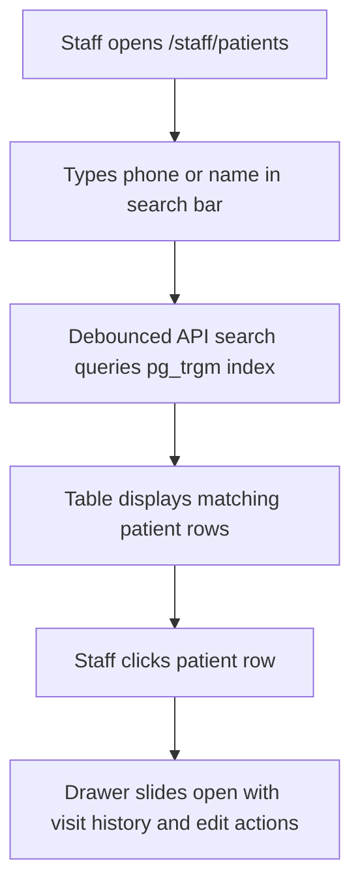

# Page Specification: Patient Search & Profile

> Route: `/staff/patients`
> Feature: F-006 Patient Search & Profile (Reception; list; P1; roles: reception, owner, doctor)
> Standard: `.claude/skills/uiux/references/page-standard.md`

---

## 1. Page overview

- **Purpose of the page:** Allow receptionists, doctors, and owners to search the entire patient directory by phone or name, view patient visit frequency, update contact details, and inspect past consultation dates.
- **The visitor it serves:** Clinic staff verifying patient records, reviewing previous visits, or correcting contact errors.
- **The one action it must drive:** Search a patient and view or update their profile.
- **PRD sections and IDs:** PRD §4 (Reception Navigation), §5.2, §5.3 (F-006 Patient Search & Profile), §14.3 (Data Privacy).
- **How a visitor arrives:** Clicks "Mareez Directory / Patients" from the staff navigation bar.

---

## 2. Section-by-section breakdown

1. **Header & Search Bar:** Arrival & Query. Search input powered by PostgreSQL trigram index with instant result counter (`bg-surface`).
2. **Patient Directory Grid:** Main Content. Table displaying Patient Name, Phone, Total Visits, Last Visit Date, Registered Date, and Actions (`bg-surface`).
3. **Patient Profile Flyout / Drawer:** Detail View. Sliding right panel showing full profile, visit timeline, and edit controls (`bg-surface-raised`).
4. **Pagination & Export Bar:** Utility. Standard cursor pagination controls and CSV export option for authorized roles (`bg-surface-sunken`).

---

## 3. Content

- **Page Header:**
  - Title: "Mareez Search aur Profile (Patient Directory)"
  - Subtitle: "Clinic ke registered mareezon ki list aur purana record"
- **Search Controls:**
  - Input Placeholder: "Naam ya mobile number se talash karein (e.g. 0300 1234567)..."
  - Results Summary: "Kul 1,248 Mareez Mojood Hain"
- **Grid Column Titles & Sample Data:**
  - Col 1: "Mareez ka Naam" -> `Muhammad Ali`
  - Col 2: "Mobile Number" -> `0300 1234567`
  - Col 3: "Jins / Umar" -> `Mard, 34 saal`
  - Col 4: "Kul Visits" -> `5 visits`
  - Col 5: "Aakhri Visit" -> `14 Oct 2026`
  - Col 6: "Actions" -> `[Profile Kholein] [Naya Token]`
- **Profile Drawer Details:**
  - Drawer Title: "Mareez Profile — Muhammad Ali"
  - Phone: `0300 1234567` (Verified)
  - Medical History Notes: "Allergy to Penicillin (Marked by Dr. Tariq)"
  - Past Visits List: "14-Oct-2026 (Dr. Tariq) · 02-Sep-2026 (Dr. Ayesha)"

---

## 4. Layout structure

- **Mobile Viewport (≤ 640px):** Single column card list, each patient card showing name, phone, visit count, and a tap-to-open drawer trigger.
- **Tablet & Desktop Viewport (≥ 641px):** Full-width master-detail view. Main screen displays data grid (65% width) while selected patient opens drawer on the right (35% width, 440px).

---

## 5. Component breakdown

1. `SearchFilterBar`: Trigram-enabled input with search icon and clear button. State: default, loading, active. (Reuse).
2. `PatientDataTable`: Accessible table with sortable columns. State: loading skeleton, empty state, default. (Reuse).
3. `PatientProfileDrawer`: Sliding side panel showing personal details and visit history. State: closed, open, editing. (New).
4. `EditPatientDialog`: Modal for updating patient name or phone number. State: hidden, open, submitting. (New).

---

## 6. Visual hierarchy

1. **First:** Prominent search bar at the top of the directory.
2. **Second:** Patient name and phone number in bold typography within the table.
3. **Third:** "Kul Visits" badge and "Profile Kholein" action button.

---

## 7. CTAs

- **Primary CTA:**
  - Label: "+ Naya Mareez Shamil Karein / Add Patient"
  - Position: Top-right header.
  - Variant: `bg-accent text-fg-inverse hover:bg-accent-hover`.
  - Destination / Action: Opens create patient dialog.
- **Secondary Actions:**
  - "Profile Kholein / View Profile" (Opens sliding detail drawer).
  - "Walk-in Token Banayein" (Directly populates F-005 form with this patient's details).

---

## 8. Media

- **Patient Avatar Initial:**
  - Purpose: Visual placeholder initial ("MA") for quick identification.
  - Dimensions: 32px × 32px circular pill (`bg-accent-subtle text-accent font-semibold`).
- **3D / Heavy Assets:**
  - Not applicable — no 3D elements on this page. Pure lightweight DOM.

---

## 9. Interactions

- **Trigram Search:** Queries execute with 300ms debounce against PostgreSQL `pg_trgm` index on `name` and `phone`.
- **Drawer Slide:** Clicking a patient row slides out the profile drawer from the right with a 240ms cubic-bezier transition.
- **Mobile Variant:** Drawer becomes a full-screen modal view with touch drag-to-dismiss gesture.
- **Reduced-Motion Variant:** When `prefers-reduced-motion: reduce` is active, profile drawer toggles display without sliding or backdrop opacity animations.

---

## 10. Diagram

```text
+--------------------------------------------------------------------------+
|  Mareez Directory (1,248 Records)            [+ Naya Mareez Shamil Karein]
|  Search: [ Muhammad Ali ya 0300...                                    ]  |
+--------------------------------------------------------------------------+
|  Naam          | Phone         | Jins/Umar | Visits | Aakhri Visit | Act |
|----------------+---------------+-----------+--------+--------------+-----|
|  Muhammad Ali  | 0300 1234567  | Mard (34) | 5      | 14-Oct-2026  | [>] |
|  Fatima Bibi   | 0321 9876543  | Aurat(28) | 2      | 28-Oct-2026  | [>] |
|  Zahid Hussain | 0333 1122334  | Mard (45) | 1      | 31-Oct-2026  | [>] |
+--------------------------------------------------------------------------+
|  [ Drawer - Muhammad Ali ]:                                              |
|  Phone: 0300 1234567  |  Allergy: Penicillin                             |
|  History: 14-Oct (Dr. Tariq Khan - Flu), 02-Sep (Checkup)                |
|  [ Edit Record ]   [ Is Mareez ka Token Banayein ]                       |
+--------------------------------------------------------------------------+
```



---

## 11. Notes

- **Implementation Notes:** Scoped by `clinic_id`. Patient names and phones from other clinics are unreachable (enforced by RLS and API query filters).
- **Performance Risks:** Must handle 50,000+ patient records with p95 search latency under 300 ms using database trigram indexes.
- **Accessibility Notes:** Drawer traps focus when open; `Esc` key closes drawer cleanly.
- **SEO Notes:** `title`: "Patient Directory — Clinic Staff", `noindex`: true.
