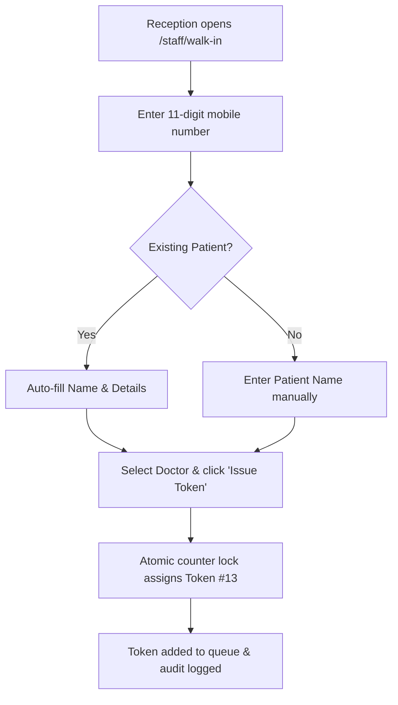

# Page Specification: Walk-in Patient Entry

> Route: `/staff/walk-in`
> Feature: F-005 Walk-in Entry (Reception; transaction; P0; roles: reception, owner)
> Standard: `.claude/skills/uiux/references/page-standard.md`

---

## 1. Page overview

- **Purpose of the page:** Allow reception staff to quickly register patients who walk directly into the clinic without prior online booking, assigning them an official queue token in the same unified sequence as online patients.
- **The visitor it serves:** Clinic receptionists interacting with patients standing in front of the counter.
- **The one action it must drive:** Enter patient phone/name, select doctor, and issue token in under 20 seconds.
- **PRD sections and IDs:** PRD §4 (Reception Navigation), §5.2, §5.3 (F-005 Walk-in Entry), §10 (W-001 Unified Numbering Flow).
- **How a visitor arrives:** Clicks "+ Naya Walk-in Token" from the top navigation or `/staff/aaj-ki-list`.

---

## 2. Section-by-section breakdown

1. **Header & Context:** Arrival & Identity. Title, active clinic, and current serving token reminder (`bg-surface`).
2. **Patient Lookup & Registration:** Search & Autofill. Phone lookup field that auto-populates existing patient records or creates a new profile (`bg-surface`).
3. **Queue Assignment Details:** Configuration. Doctor selector, fee/notes field, and priority/urgent checkbox (`bg-surface`).
4. **Token Preview & Actions:** Primary Conversion. Large issued token number preview, "Token Banayein / Issue Token" button, and optional print slip toggle (`bg-surface`).
5. **Recent Walk-ins Footnote:** Audit & Continuity. Table showing the last 3 tokens issued by reception today (`bg-surface-sunken`).

---

## 3. Content

- **Page Header:**
  - Title: "Walk-in Mareez Entry (Counter Token)"
  - Subtitle: "Jo mareez direct clinic aayein, unka token yahan banayein."
- **Patient Form Controls:**
  - Phone Label: "Mareez ka Mobile Number *"
  - Phone Placeholder: "0300 1234567"
  - Phone Subtext: "Number likhte hi purana record samne aa jayega."
  - Name Label: "Mareez ka Naam *"
  - Name Placeholder: "e.g. Tariq Mehmood"
  - Gender Label: "Jins (Gender)"
  - Gender Options: "Mard (Male) | Aurat (Female) | Bacha (Child)"
- **Queue Controls:**
  - Doctor Label: "Doctor Chunein *"
  - Doctor Selector: "Dr. Tariq Khan (Room 1) — Agla Token: #13"
  - Immediate Arrival: "[x] Mareez clinic mein mojood hai (Mark Arrived immediately)"
- **Primary CTA:**
  - Button Text: "Token Jari Karein / Issue Token (#13)"
- **Success Slip Preview:**
  - Dialog Title: "Token Ban Gaya!"
  - Slip Body: "Token #13 — Dr. Tariq Khan — Tariq Mehmood"
  - Slip Subtext: "Estimated wait: ~25 minute"

---

## 4. Layout structure

- **Mobile Viewport (≤ 640px):** Single column full width, inputs stacked vertically with large touch-friendly input fields (40px height), bottom sticky "Issue Token" button.
- **Tablet & Desktop Viewport (≥ 641px):** Two-column split layout or centered 720px form container: left side patient information, right side doctor queue status and preview summary.

---

## 5. Component breakdown

1. `WalkinFormShell`: Standard form wrapper following the mandated PRD layout. State: default, submitting. (Reuse).
2. `AutofillPhoneInput`: Input with immediate lookup query to `/api/v1/patients?phone=...`. State: default, searching, matched patient found. (New).
3. `DoctorQueueBadge`: Displays next available token number for selected doctor. State: active, quota warning. (New).
4. `IssueTokenButton`: High-contrast primary action button with keyboard shortcut (`Ctrl+Enter`). State: default, loading, success checkmark. (Reuse).

---

## 6. Visual hierarchy

1. **First:** "Next Available Token #13" badge for the selected doctor.
2. **Second:** Mobile number input with instant patient name auto-completion.
3. **Third:** High-contrast blue "Token Jari Karein" primary action button.

---

## 7. CTAs

- **Primary CTA:**
  - Label: "Token Jari Karein / Issue Token (#13)"
  - Position: Pinned to bottom of the form container.
  - Variant: `bg-accent text-fg-inverse hover:bg-accent-hover`.
  - Destination / Action: Calls `POST /api/v1/tokens` (source: `walk_in`).
  - Success State: Shows success slip modal, prints if enabled, and resets form for next patient.
- **Secondary Actions:**
  - "Clear / Reset Form" (`Esc` key).
  - "Print Parchi" (Secondary ghost button).

---

## 8. Media

- **Print Icon:**
  - Purpose: Indicates thermal printer integration or browser print dialog trigger.
  - Dimensions: 20px × 20px SVG icon.
- **3D / Heavy Assets:**
  - Not applicable — no 3D elements on this page. Pure lightweight DOM.

---

## 9. Interactions

- **Phone Number Lookup:** As soon as 11 digits are typed, system fetches patient history via API. If found, patient name and gender populate automatically with a 150ms gentle fade.
- **Keyboard Shortcut:** Pressing `Ctrl + Enter` immediately triggers form submission for rapid desk operation.
- **Mobile Variant:** Displays full-screen modal layout with automatic number pad keyboard on phone field.
- **Reduced-Motion Variant:** When `prefers-reduced-motion: reduce` is active, autofilled fields appear instantaneously without opacity fade animations.

---

## 10. Diagram

```text
+--------------------------------------------------------------------------+
|  Walk-in Mareez Entry (Counter Token)                    Date: 31-Oct    |
+--------------------------------------------------------------------------+
|  Mobile Number: [ 0300 1234567          ]  (Record Mil Gaya: M. Ali)     |
|  Mareez ka Naam:[ Muhammad Ali          ]  Jins: [ Mard (Male) v ]       |
+--------------------------------------------------------------------------+
|  Doctor:        [ Dr. Tariq Khan (Room 1)                       v ]      |
|  Queue Status:  Agla number: #13  |  Abhi chal raha: #08                 |
|  [x] Mareez clinic mein mojood hai (Mark as Arrived)                     |
+--------------------------------------------------------------------------+
|  [================ Token Jari Karein - #13 (Ctrl+Enter) ===============] |
+--------------------------------------------------------------------------+
|  Aakhri 3 Walk-in Tokens:                                                |
|  #12 (06:42 PM) - M. Akram  |  #09 (06:20 PM) - Fatima  |  #05 (05:40 PM) |
+--------------------------------------------------------------------------+
```



---

## 11. Notes

- **Implementation Notes:** Concurrency safe. Token number allocated inside an atomic SQL transaction with row lock on `token_counters` (`SELECT ... FOR UPDATE`).
- **Performance Risks:** Must submit and return within 300 ms so reception queue does not build up.
- **Accessibility Notes:** Strict `tabIndex` flow from Phone → Name → Doctor → Submit button for mouse-free operation.
- **SEO Notes:** `title`: "Walk-in Entry — Clinic Reception", `noindex`: true.
