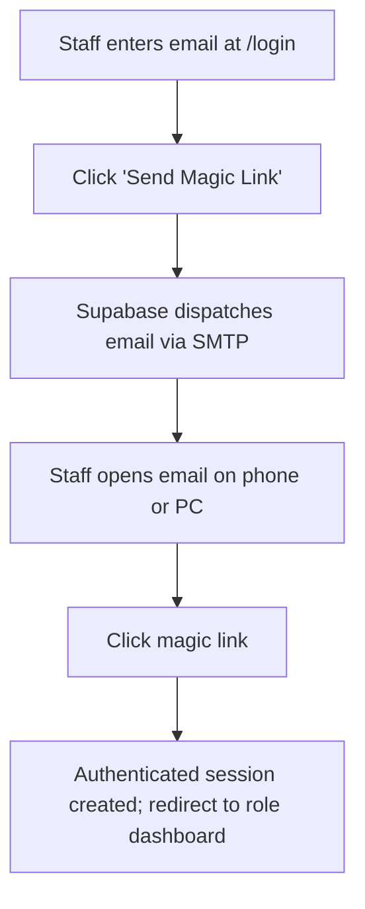

# Page Specification: Staff Login

> Route: `/login`
> Feature: F-012 Staff Login (Staff; transaction; P0; roles: all staff)
> Standard: `.claude/skills/uiux/references/page-standard.md`

---

## 1. Page overview

- **Purpose of the page:** Allow clinic staff (owners, doctors, receptionists, and platform administrators) to log in securely without passwords via an email magic link.
- **The visitor it serves:** Clinic team members arriving on desktop, tablet, or mobile browsers.
- **The one action it must drive:** Enter registered work email and click "Login Link Bhejein / Send Magic Link".
- **PRD sections and IDs:** PRD §4 (Staff Navigation), §5.2, §5.3 (F-012 Staff Login), §14 (Security & Authentication), §3.6 (Custom SMTP).
- **How a visitor arrives:** Types clinic admin URL, clicks "Staff Login" from footer, or is redirected by an authentication guard from protected staff routes.

---

## 2. Section-by-section breakdown

1. **Brand Identity Header:** Arrival & Context. System logo, application title, and security badge (`bg-surface`).
2. **Email Login Form:** Conversion. Single-field email input, remember device checkbox, and primary submit button (`bg-surface`).
3. **Magic Link Sent Confirmation:** Post-Submission Feedback. Reassuring confirmation showing sent address, countdown timer, and resend option (`bg-surface`).
4. **Security & Privacy Footnote:** Reassurance. Notice confirming single-use 15-minute token expiry and zero password storage (`bg-surface-sunken`).

---

## 3. Content

- **Brand Header:**
  - System Name: "Clinic Token & Queue SaaS"
  - Screen Title: "Staff Login Panel"
  - Tagline: "Reception, Doctor aur Owner ke liye mehfooz login"
- **Form Controls:**
  - Email Label: "Aap ka Registered Email Address *"
  - Email Placeholder: "doctor@clinic.com ya staff@clinic.com"
  - Email Helper: "Is email par 1-tap login link bheja jayega (Password ki zaroorat nahi)."
- **Primary CTA:**
  - Button Text: "Login Link Bhejein / Send Magic Link"
- **Link Sent State:**
  - Heading: "Email Check Karein! (Check your inbox)"
  - Body: "Humne login link aapke email par bhej diya hai. Link par click kar ke foran login karein."
  - Expiry Notice: "Yeh link 15 minute ke baad expire ho jayega."
  - Resend Link: "Email nahi mila? Dobara bhejein (60s countdown)"

---

## 4. Layout structure

- **Mobile Viewport (≤ 640px):** Single column, 100% width, container padding 16px (`p-4`), card centered vertically.
- **Tablet & Desktop Viewport (≥ 641px):** Centered card container, max-width 420px (`--layout-form-max`), vertical centered in viewport (`min-h-screen flex items-center justify-center`), surrounded by `--color-canvas`.

---

## 5. Component breakdown

1. `LoginCardShell`: Elevated container with brand header and footer. State: default, loading. (Reuse).
2. `EmailInputField`: Validated email input with icon. State: default, focus, error, disabled. (Reuse).
3. `MagicLinkSentView`: State displayed after successful email dispatch. State: countdown active, resend ready. (New).
4. `PrimaryActionButton`: Full-width submit button. State: default, sending (spinner), success checkmark. (Reuse).

---

## 6. Visual hierarchy

1. **First:** "Staff Login Panel" title and clinic system logo.
2. **Second:** Prominent email input box with clean focus border.
3. **Third:** High-contrast blue "Send Magic Link" primary button.

---

## 7. CTAs

- **Primary CTA:**
  - Label: "Login Link Bhejein / Send Magic Link"
  - Position: Directly below email input field.
  - Variant: `bg-accent text-fg-inverse hover:bg-accent-hover`.
  - Destination / Action: Triggers Supabase Auth `signInWithOtp({ email })`.
  - Success State: Flips card to `MagicLinkSentView`.
- **Secondary Actions:**
  - "Dobara bhejein / Resend Link" (Ghost link active after 60-second cooldown).

---

## 8. Media

- **Security Lock Icon:**
  - Purpose: Visual indicator of end-to-end encrypted magic link authentication.
  - Dimensions: 24px × 24px inline SVG.
- **3D / Heavy Assets:**
  - Not applicable — no 3D elements on this page. Pure lightweight DOM.

---

## 9. Interactions

- **Submit Tap:** Form validates email regex on blur. On submit, button transitions to spinner state with 150ms ease-out.
- **Card Flip / Replacement:** Form smooth fades to confirmation view with 180ms opacity and translateY transition.
- **Mobile Variant:** Full width on small touch screens with automatic mobile keyboard type `email`.
- **Reduced-Motion Variant:** When `prefers-reduced-motion: reduce` is detected, confirmation replaces the form instantly without fade or slide transitions.

---

## 10. Diagram

```text
+------------------------------------------+
|       [Logo] Clinic Token System         |
|           Staff Login Panel              |
|  Reception, Doctor aur Owner ke liye     |
+------------------------------------------+
|  Registered Email:                       |
|  [ doctor@clinic.com                   ] |
|  Link 15 minute ke liye active rahega    |
|                                          |
|  [=== Login Link Bhejein (Magic Link) =] |
+------------------------------------------+
|  Mehfooz Single-Use Link - No Passwords  |
+------------------------------------------+
```



---

## 11. Notes

- **Implementation Notes:** Powered by Supabase Auth OTP. In development, uses Gmail SMTP app password. Zero SMS charges. Rate limited to 3 requests per 5 minutes per IP.
- **Performance Risks:** Minimal DOM weight, bundle under 60 KB gzip.
- **Accessibility Notes:** High contrast inputs, error message linked via `aria-errormessage`.
- **SEO Notes:** `title`: "Staff Login — Clinic SaaS", `noindex`: true.
