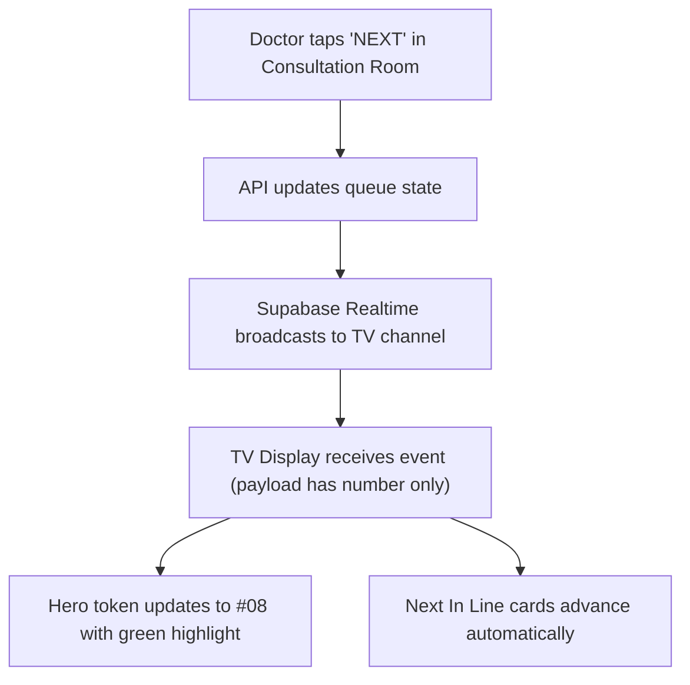

# Page Specification: Waiting Room TV Screen

> Route: `/tv`
> Feature: F-009 TV Screen (Waiting room; list; P0; role: display device)
> Standard: `.claude/skills/uiux/references/page-standard.md`

---

## 1. Page overview

- **Purpose of the page:** Wall-mounted 10-foot television display in the clinic waiting area showing currently serving and upcoming tokens in extra-large typography, eliminating the need for staff to shout patient names or numbers.
- **The visitor it serves:** Waiting patients and family members sitting across the room (10 to 30 feet viewing distance).
- **The one action it must drive:** Display high-contrast queue numbers clearly so patients immediately know when their turn has arrived.
- **PRD sections and IDs:** PRD §4 (Display Navigation), §5.2, §5.3 (F-009 TV Screen), §10 (W-004 Queue Management Flow).
- **How a visitor arrives:** Clinic staff boots a Smart TV browser, Raspberry Pi, or HDMI computer and opens `/tv` (paired via display device token).

---

## 2. Section-by-section breakdown

1. **TV Header Ribbon:** Identity & Clock. Displays clinic name, current date, live status dot, and large digital clock in Asia/Karachi time (`bg-tv-surface`).
2. **Now Serving Hero Block:** Arrival & Focus. Extra-large display of the token currently inside the consultation room (`bg-tv-surface`).
3. **Next In Line Strip:** Anticipation & Queue Preview. Horizontal or grid cards displaying the next 3–4 upcoming token numbers (`bg-surface-sunken`).
4. **Clinic Announcement Footer:** Information & Politeness. Ticker text reminding patients to keep slips ready and switch phones to silent (`bg-tv-surface`).

---

## 3. Content

- **Header Ribbon:**
  - Clinic Branding: "Aapka Family Clinic — OPD Queue"
  - Digital Clock: "06:45 PM (Asia/Karachi)"
  - Live Status Dot: "● Live System"
- **Now Serving Hero Section:**
  - Card Heading: "ABHI CHAL RAHA HAI / NOW SERVING"
  - Large Token Number: "#08"
  - Doctor Name & Room: "Dr. Tariq Khan — Kamra No. 1 (Room 1)"
  - Status Subtext: "Baraye meharbani andar tashreef layein / Please enter"
- **Next In Line Cards:**
  - Section Heading: "AGLE NUMBER / NEXT IN LINE"
  - Next Token 1: "#09" (Dr. Tariq Khan) — "Tayyar Rahein"
  - Next Token 2: "#10" (Dr. Tariq Khan) — "Waiting"
  - Next Token 3: "#11" (Dr. Tariq Khan) — "Waiting"
  - Next Token 4: "#12" (Dr. Tariq Khan) — "Waiting"
- **Footer Notice Ticker:**
  - Urdu/English Announcement: "Baraye meharbani mobile phone silent karein aur parchi tayyar rakhein. / Please keep your token ready and phone on silent."

---

## 4. Layout structure

- **Display Resolution:** Optimized for 1080p (1920×1080) and 4K (3840×2160) widescreen 16:9 displays.
- **Viewport Structure:** Fixed 100vw × 100vh kiosk layout, zero scrollbars (`overflow: hidden`).
- **Split Screen Hierarchy:**
  - Header: Top 10% height (108px on 1080p).
  - Main Serving Hero: 65% height, centered large typography.
  - Next Tokens Rail: 18% height, 4 evenly spaced columns.
  - Footer Ticker: Bottom 7% height.
- **Responsive Handling:** Scales proportionally via CSS `vh`/`vw` units. On smaller monitor checks, adapts cleanly without truncation.

---

## 5. Component breakdown

1. `TVHeaderBar`: Top banner with clinic logo, live connection pill, and auto-updating digital clock. State: connected, disconnected (red alert). (New).
2. `TVNowServingHero`: Massive `#08` counter with pulse border on number change. State: default, token advance flash. (New).
3. `TVNextQueueCards`: Row of upcoming token cards with doctor names. State: default, loading, empty. (New).
4. `TVNoticeTicker`: Bottom scrolling/static announcement ribbon. State: default. (New).

---

## 6. Visual hierarchy

1. **First:** Giant emerald token number (`#08`) rendered in `--text-4xl` (72px–120px equivalent), visible from 30 feet away.
2. **Second:** "NOW SERVING" label and Doctor Room indicator.
3. **Third:** The "Agle Number" queue list showing next patients in line.

---

## 7. CTAs

- **Primary CTA:**
  - Not applicable — Television display is an automated non-interactive screen with zero buttons or cursor interactions.
- **Secondary Actions:**
  - Not applicable — Configuration is handled remotely via F-020 Display Pairing.

---

## 8. Media

- **Live Pulse Dot:**
  - Purpose: Visual verification that the TV web socket is active and not frozen.
  - Dimensions: 12px × 12px glowing emerald dot (`animate-pulse`).
- **3D / Heavy Assets:**
  - Not applicable — no 3D elements on this page. Pure lightweight DOM.

---

## 9. Interactions

- **Token Advance Transition:** When doctor presses NEXT, the large token number flashes with a 200ms ease-out green backlight ripple, transitioning from the old number to the new number.
- **Mobile Variant:** Not applicable — designed strictly for TV displays; on small viewports, elements stack vertically in full width.
- **Reduced-Motion Variant:** When `prefers-reduced-motion: reduce` is enabled on the browser box, number changes occur instantaneously with zero green glow ripple or transform effects.

---

## 10. Diagram

```text
+--------------------------------------------------------------------------+
|  [Logo] Aapka Family Clinic                    ● Live       06:45 PM PKT |
+--------------------------------------------------------------------------+
|                                                                          |
|                     ABHI CHAL RAHA HAI / NOW SERVING                      |
|                                                                          |
|                                  #08                                     |
|                                                                          |
|                       Dr. Tariq Khan - Room 1                            |
|                 Baraye meharbani andar tashreef layein                   |
|                                                                          |
+--------------------------------------------------------------------------+
|  AGLE NUMBER / NEXT:                                                     |
|  [ #09 - Tayyar Rahein ]  [ #10 - Waiting ]  [ #11 - Waiting ]  [ #12 ]  |
+--------------------------------------------------------------------------+
|  Notice: Baraye meharbani apna phone silent rakhein aur parchi tayyar... |
+--------------------------------------------------------------------------+
```



---

## 11. Notes

- **Implementation Notes:** Zero PII is transmitted to the TV. Realtime broadcast payload contains only doctor ID, current token number, and next token numbers (no patient names or phones).
- **Performance Risks:** Must run indefinitely in TV browser memory without leaking memory or crashing (long-running Chromium tab).
- **Accessibility Notes:** Extra-high contrast ratio (9.6:1 AAA white on dark emerald ground) for maximum legibility in bright waiting room ambient lighting.
- **SEO Notes:** `title`: "Waiting Room Display — Aapka Clinic", `noindex`: true.
